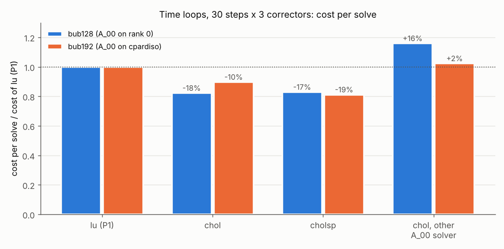
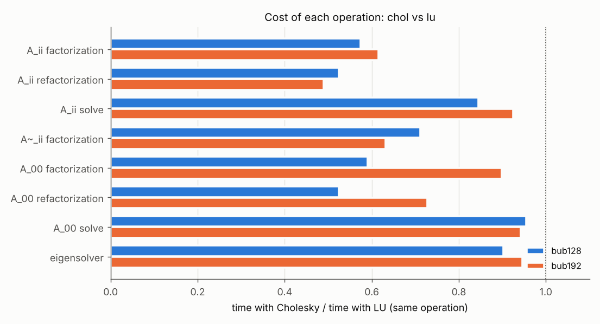
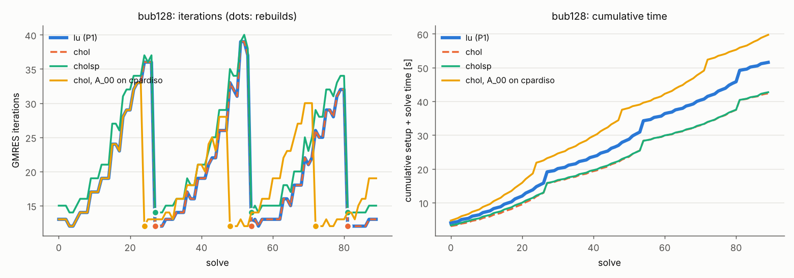
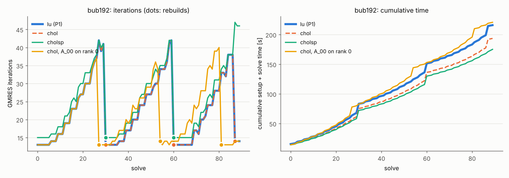

# Symmetric factorizations and single precision (P2) on G100: results

Job `run_cholesky_23012394` (`Allrun_p2.sh`): 5 nodes x 48 = 240 MPI processes, local factorizations
with MKL PARDISO, A_00 with `cluster_sparse_solver` on 48 processes, on rank 0 when n0 < 10000.
Sources: P2 (md5 `b41f63a702b7`, `src_hash.txt`). Unit tests on 16 processes: all passed, including
`test_factorization` (97 checks), which verifies the distributed Cholesky of cpardiso with Intel MPI
(mtype 2, and the move to mtype -2 when the probe solve detects an indefinite A_00). Full tables:
[`report.md`](run_cholesky_23012394/report.md). The plots below were made from the CSV files and
logs of the run.

Variants (same problems as P1, `--reuse auto`, 30 steps x 3 correctors):
`lu` = P1 configuration (LU for A_ii and A~_ii; A_00 in LU on rank 0, in LDL^T with cpardiso),
`chol` = P2 defaults (Cholesky for A_ii, A~_ii + sigma I and A_00), `cholsp` = `chol` with the factors
of A_ii in single precision, `chol_cp` / `chol_root` = `chol` with the other coarse solver.

## In short

| problem | `lu` [s/solve] | `chol` | `cholsp` | `chol`, other A_00 solver |
|:--|--:|--:|--:|--:|
| bubbles3d 128^3, rho 1000 (A_00 on rank 0, n0 ~ 6000) | 0.573 | 0.471 (**-18%**) | 0.474 (-17%) | cpardiso: 0.663 (+16%) |
| bubbles3d 192^3, rho 1000 (A_00 on cpardiso, n0 ~ 12600) | 2.400 | 2.151 (**-10%**) | 1.947 (-19%, see below) | rank 0: 2.454 (+2%) |
| G3_circuit / thermal2 / ecology2, one solve [s] | 13.51 / 2.55 / 1.63 | -1% / -6% / -3% | - | - |

- **Same preconditioner, lower cost:** `lu` and `chol` give identical iteration sequences and rebuild
  steps in both time loops; only the cost of the factorizations and solves changes.
- All 720 time-loop solves and the 6 single solves converged (true residual <= 1e-8). On the bubbles
  problems no factorization chain had to fall back and no refactorization fell back to a full one.
- No timing bursts in this job: costs with median times agree with the measured ones within 1%.

## Plots

Cost of each operation (timers averaged over the ranks, per factorization, refactorization or
GMRES iteration), `chol` vs `lu`:

- factorizations and refactorizations of A_ii and of the root A_00: **-40% to -50%**; factorization
  of A~_ii + sigma I: -30% to -37%;
- refactorization of A_00 with cpardiso (mtype 2 instead of -2): **-27%**; its setup only -10%,
  because the analysis (METIS ordering on the first process) dominates and is unchanged;
- solves: A_ii -16% (128^3) and -8% (192^3), A_00 -5% to -6%. A Cholesky solve still reads the factor
  twice (L, then L^T), and the root coarse solve is dominated by the gather/scatter;
- eigensolver -5% to -10%: most of it is the dense work of Arnoldi.

`lu` (thick) and `chol` (dashed) overlap exactly. `cholsp` needs ~2 more iterations per solve
(12-13 -> 14-15 right after a rebuild). With the other coarse solver the cost of an iteration
changes, and so do the rebuild steps chosen by the break-even rule.

## Single precision

- **128^3: no gain.** The solves with A_ii are 40% cheaper than with `chol`, but the iterations go
  from 20.2 to 22.3 per solve, and every extra iteration also costs a coarse solve.
- **192^3: about -5% vs `chol`.** The measured -9.5% includes one rebuild less: `chol` (and `lu`)
  rebuild at step 29, the last of the test, where a rebuild cannot pay back, while `cholsp` does not.
  Up to step 28, with the same rebuild steps in all three runs: 2.288 / 2.042 / 1.931 s per solve
  for `lu` / `chol` / `cholsp`.
- The default stays double precision; `--local-precision single` is an option for large subdomains.

## Coarse solver with Cholesky

| | coarse solve [ms/iteration] | A_00 refactorization [s] | cost/solve |
|:--|--:|--:|--:|
| 128^3, n0 ~ 6000: rank 0 / cpardiso | **7.4** / 17.9 | **0.17** / 0.19 | **0.471** / 0.663 |
| 192^3, n0 ~ 12600: cpardiso / rank 0 | **19.5** / 29.0 | **0.61** / 1.22 | **2.151** / 2.454 |

The threshold `--coarse-root-below 10000` measured with LU in P1 still holds with Cholesky.

## SuiteSparse matrices (one solve)

The setup is dominated by the eigensolver and by the analysis of the cpardiso factorization of A_00
(up to 2.1 s on one process for G3_circuit); Cholesky only shortens the numerical part
(0.81 -> 0.61 s), hence -1% to -6%. On G3_circuit the Cholesky factorization of A~_ii + sigma I fails
on 194 of 240 ranks and the chain moves to LDL^T (thermal2: 18 ranks): these matrices are not
diagonally dominant, so A~_ii can be indefinite (Lemma 3.2 of the paper does not apply). The failed
attempt costs ~14 ms per setup.

## Where the time goes with `chol`

Share of the total setup + update + solve time (timers averaged over the ranks):

| | coarse solves | local solves | eigensolver | A_00 (re)factorizations | A_00 = V^T A V in refactorizations | products with V | A_ii (re)factorizations |
|:--|--:|--:|--:|--:|--:|--:|--:|
| 128^3 (42.4 s) | 32% | 16% | 19% | 14% | 2% | 3% | 3% |
| 192^3 (193.6 s) | 20% | 21% | 19% | 13% | 6% | 6% | 3% |

- The coarse part (solves + factorizations) is now the largest item at 128^3, about half of every
  iteration and 73% of every refactorization: the target of P5 (fewer coarse vectors per subdomain).
- The eigensolver is ~70% of every rebuild: P5 with a cap on `--nev` and P3 address it.
- At 192^3 the recomputation of A_00 (`CoarseSpace::computeEntries()`) takes 0.43 s of the 1.30 s of
  a refactorization: reordering its two products is a small code change worth doing.
