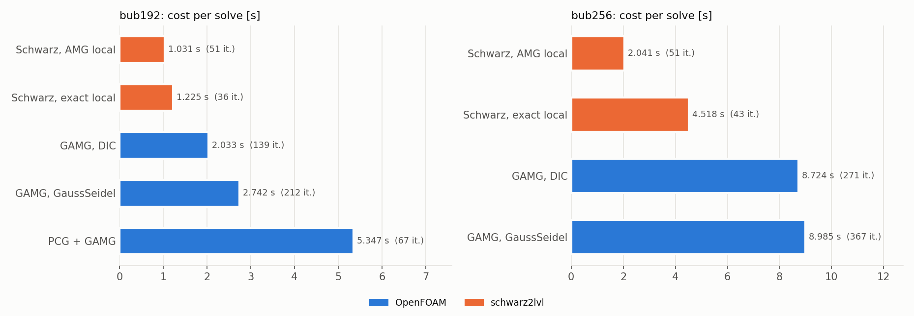
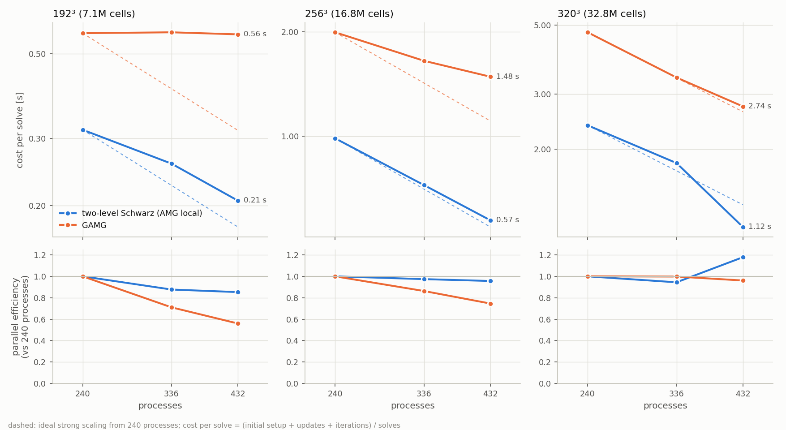
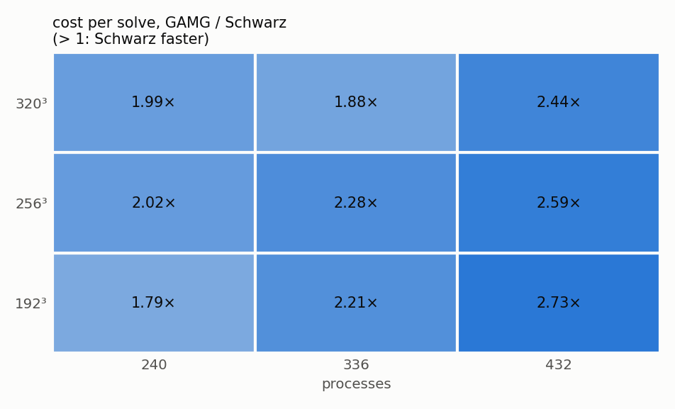
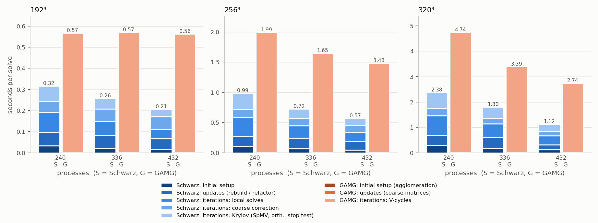
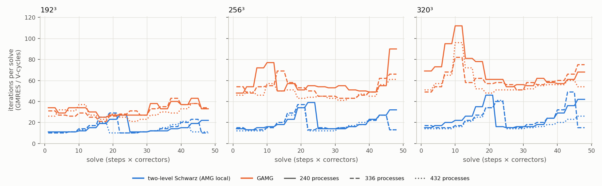
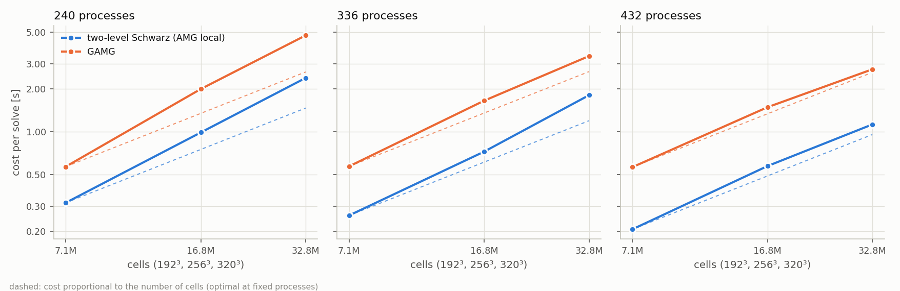
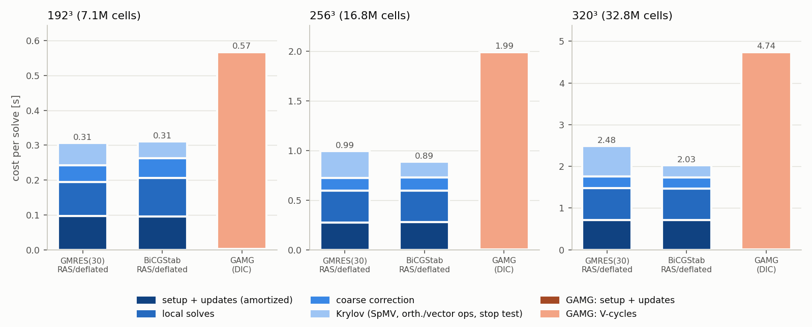
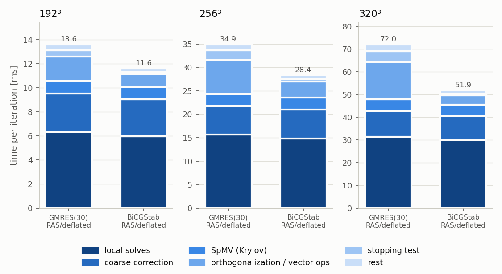
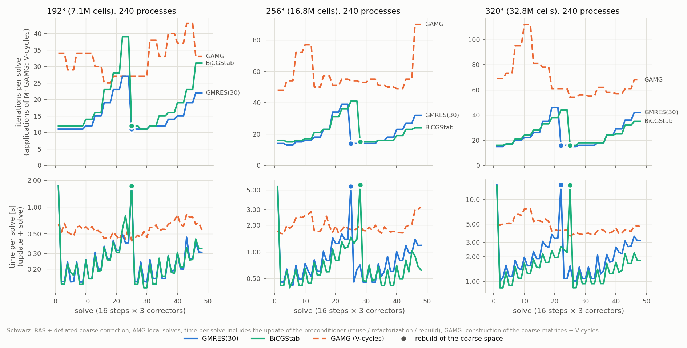

# GAMG reference on G100: results

The goal of the project is a preconditioner competitive with the GAMG of OpenFOAM. These campaigns
measure where the two-level Schwarz preconditioner stands **before any porting**: OpenFOAM
(`openfoam/bubblyPressureFoam`) and `schwarz2lvl` solve the same pressure matrices, the bubbles3d
problem of P5/P7b (−∇·(β∇p) = α, β = 1/ρ, 150 rising gas bubbles, density ratio 1000, 0.5 cells of
rise per step, 3 solves per step, every solve from 0).

| campaign | script | what | outcome |
|:--|:--|:--|:--|
| `run_gamg_23036378` | `Allrun_gamg.sh` (first version) | 5 OpenFOAM variants vs Schwarz `amg` / `exact`, 192³ and 256³, 240 processes, to ~1e-8 | reconnaissance only: OpenFOAM matrices not identical (section 1), timed out at 256³ |
| `run_gamg_23038420` | `Allrun_gamg.sh` | GAMG_DIC, GAMG_GS, PCG_GAMG vs `amg`, `exact`, same problems, **to 1e-8** in the 2-norm | asymptotic comparison, [`report.md`](run_gamg_23038420/report.md) |
| `run_scaling_np240_23040226`, `_np336_23040227`, `_np432_23040228` | `Allrun_scaling.sh` | GAMG_DIC vs `amg`, 192³ / 256³ / 320³ × 240 / 336 / 432 processes, **relTol 1e-2** of the OpenFOAM residual for both | practical tolerance and scaling, [`report.md`](scaling_report/report.md) |
| `run_krylov_np240_r1e-2_23091304` | `Allrun_krylov.sh` | the same Schwarz preconditioner inside GMRES(30) and inside **BiCGStab**, 192³ / 256³ / 320³, 240 processes, relTol 1e-2 | Krylov method (section 5) |

Schwarz = `--tau 0.3 --nev 8 --eig-tol 1e-4` (coarse space of P5), `--local-approx amg` (one AMG
V-cycle per local solve, P7b; `exact`: Cholesky factors of A_ii), `--reuse auto`, coarse problem on
rank 0 (n0 < 10000). GAMG = OpenFOAM-10 defaults, `faceAreaPair` agglomeration, DIC (`GAMG_DIC`) or
GaussSeidel (`GAMG_GS`) smoother. Times: every solve between two synchronizations of all processes;
Schwarz pays its initial setup, rebuilds and refactorizations, GAMG the construction of its coarse
matrices in every solve. Matrix assembly (OpenFOAM) and matrix generation (schwarz2lvl) are not
part of the costs.

## In short

| campaign | stopping test | 192³ | 256³ | 320³ |
|:--|:--|--:|--:|--:|
| `run_gamg_23038420`, 240 processes | ‖r‖₂/‖b‖₂ ≤ 1e-8 | **2.0×** | **4.3×** | – |
| scaling, 240 processes | Σ\|r\| ≤ 1e-2 Σ\|b\| | **1.8×** | **2.0×** | **2.0×** |
| scaling, 336 processes | Σ\|r\| ≤ 1e-2 Σ\|b\| | **2.2×** | **2.3×** | **1.9×** |
| scaling, 432 processes | Σ\|r\| ≤ 1e-2 Σ\|b\| | **2.7×** | **2.6×** | **2.4×** |

Cost per solve of GAMG_DIC (the fastest OpenFOAM variant) divided by the cost per solve of the
two-level Schwarz with AMG local solves, setup and updates included (> 1: Schwarz faster).

1. **Same problem, verified.** OpenFOAM assembles the generated matrix and right-hand side to
   3.6e-15 / 1.0e-14 (24³ case against `matgen`, gated: the jobs stop otherwise). 864 + 492 solves
   (scaling + `run_gamg_23038420`), all converged.
2. **GAMG needs more and more V-cycles as the mesh is refined; the Schwarz iterations grow
   mildly.** At 240 processes: GAMG 139 → 271 V-cycles per solve to 1e-8 (192³ → 256³) and
   32 → 58 → 69 to relTol 1e-2 (192³ → 256³ → 320³); Schwarz, right after a rebuild, 32 → 39 and
   11 → 14 → 15. The geometric agglomeration does not see the density jumps (see *Interpretation*).
3. **An iteration costs the same as a V-cycle** at 240 processes (13.4 / 14.6 ms at 192³,
   33.1 / 32.2 ms at 256³ to 1e-8; 34.8 / 34.5 and 68.9 / 68.8 ms at 256³ / 320³ to 1e-2): the whole
   gain is in the number of iterations, 2.0-2.9× fewer at 1e-2, 2.7-5.4× fewer at 1e-8.
4. **At the practical tolerance the gain is smaller but holds everywhere: 1.8-2.7×.** At 1e-2 the
   setup weighs more (27-35% of the Schwarz cost, against < 0.5% for GAMG), and the first two
   decades are the slowest ones of GMRES (5.5-8 iterations per decade after a rebuild, against 4-5
   over eight decades), while GAMG converges at its asymptotic rate from the first V-cycle (16 / 29
   V-cycles per decade at 1e-2 against 17 / 34 at 1e-8). At 256³ the ratio drops from 4.3× to 2.0×.
5. **Schwarz scales better.** Parallel efficiency 240 → 432 processes: Schwarz 0.85 / 0.96 / 1.18,
   GAMG 0.56 / 0.75 / 0.96 (192³ / 256³ / 320³). At 192³ GAMG does not speed up at all (0.567 →
   0.563 s per solve: its V-cycle gets slower, 17.4 → 19.4 ms). The ratio grows with the processes.
6. **Where the Schwarz time goes** (1e-2): setup and updates ~30%, local AMG V-cycles 21-33%,
   Krylov (SpMV, orthogonalization, stopping test) 17-27% — orthogonalization and stopping test
   alone 12-20% —, coarse correction 11-29% (growing with the processes: n0 = 8 per subdomain,
   solved on rank 0).
7. **The anomalies of the previous campaigns are gone**: initial setup / median rebuild = 0.98-1.03
   in all 9 runs (it was 11 and 15 in the first Schwarz run of the two GAMG jobs), regular rebuilds.
8. **BiCGStab instead of GMRES removes most of the Krylov overhead** (section 5): same preconditioner,
   1.04-1.20× the applications, each 0.72-0.85× as expensive; cost per solve 1.02 / 0.89 / 0.82× that
   of GMRES at 192³ / 256³ / 320³, so 1.8 / 2.2 / 2.3× cheaper than GAMG at 240 processes.

## 1. Reconnaissance: `run_gamg_23036378`

Five OpenFOAM variants at 192³ (20 steps × 3 correctors, 240 processes), to `relTol 1e-8` of the
OpenFOAM residual (true 2-norm residual up to 1.2e-7):

| variant | V-cycles / iterations per solve (avg / max) | cost per solve [s] |
|:--|--:|--:|
| GAMG, DIC smoother (`GAMG_DIC`) | 121.5 / 161 | **1.74** |
| GAMG, GaussSeidel (`GAMG_GS`, the usual p / p_rgh setup) | 186.2 / 285 | 2.57 |
| GAMG, `algebraicPair` agglomeration (`GAMG_ALG`) | 228.9 / 431 | 2.97 |
| PCG + 2 GAMG V-cycles (`PCG_GAMG`) | 59.0 / 112 | 4.75 |
| PCG + DIC (`PCG_DIC`, one level) | 2018.7 / 2059 | 2.40 |

- GAMG_DIC is the fastest OpenFOAM variant; the coefficient-based `algebraicPair` agglomeration is
  slower than the geometric one and much more erratic (max 431 at 192³, 935 at 256³); PCG with GAMG
  as preconditioner halves the iterations but each costs ~5.5 V-cycles of GAMG_DIC.
- **Not a valid comparison**: the matrix check failed (OpenFOAM matrix differed from the generated
  one by 0.5 relative to the largest entry, 2 of the 150 bubbles at another position). The bubble
  field compiled by the OpenFOAM toolchain of G100 (icpx oneAPI 2021, `-O3 -xCORE-AVX512`) drew
  different bubble positions; g++ and clang agree to 1e-15. Since then the bubble field of the
  application is compiled with the schwarz2lvl compiler and linked through a C interface, and the
  jobs stop if the matrices differ. The job hit the 70-minute limit in 256³ (PCG_GAMG, 8 of 48
  solves).

## 2. Asymptotic comparison: `run_gamg_23038420` (to 1e-8)

Same matrices (check `OK`, 3.6e-15), same accuracy: Schwarz to ‖r‖₂/‖b‖₂ = 1e-8, OpenFOAM to
`relTol 1e-9` of its residual (true 2-norm residual ≤ 1.1e-8). 240 processes; 192³ 20 steps, 256³
16 steps, 3 correctors.

| problem | variant | its avg / max | ms per iteration | cost per solve [s] | median [s] | vs GAMG_DIC |
|:--|:--|--:|--:|--:|--:|--:|
| 192³ | Schwarz `amg` | 50.7 / 131 | 13.4 | **1.03** | 0.55 | **0.51×** |
| | Schwarz `exact` | 35.9 / 52 | 28.3 | 1.23 | 1.10 | 0.60× |
| | GAMG_DIC | 139.1 / 182 | 14.6 | 2.03 | 2.00 | 1 |
| | GAMG_GS | 212.2 / 315 | 12.9 | 2.74 | 2.60 | 1.35× |
| | PCG_GAMG | 66.9 / 130 | 79.9 | 5.35 | 5.22 | 2.63× |
| 256³ | Schwarz `amg` | 50.6 / 93 | 33.1 | **2.04** | 1.51 | **0.23×** |
| | Schwarz `exact` | 42.9 / 62 | 84.1 | 4.52 | 3.82 | 0.52× |
| | GAMG_DIC | 270.8 / 357 | 32.2 | 8.72 | 8.32 | 1 |
| | GAMG_GS | 367.1 / 477 | 24.5 | 8.99 | 8.47 | 1.03× |

*median*: median cost of the solves after the first (no initial setup). Full tables:
[`report.md`](run_gamg_23038420/report.md).

- GAMG doubles its V-cycles from 192³ to 256³ (139 → 271, DIC; 212 → 367, GaussSeidel); the average
  Schwarz iterations stay at 51, right after a rebuild they grow from 32 to 39 (`exact`: 30 → 36).
- AMG local solves beat exact Cholesky factors here too (P7b): 2.1× / 2.5× cheaper per iteration
  for 1.4× / 1.2× more iterations.
- **Cold start of the first run (fixed afterwards, see 4.).** In the first Schwarz run of each job
  (`bub192_amg`, here and in `run_gamg_23036378`) the factorizations of Ã_ii in the eigensolver took
  14.3-15.0 s (18.2-18.6 s in the first job) on *every* process over the whole run, while a complete
  rebuild took 1.5 s; later runs of the same job did not show it (`bub192_exact`: initial setup
  2.0 s = rebuild 1.9 s). The initial setup (16.3 s, 21.6 s in the
  first job) entered the reuse policy as the cost of a rebuild, so the first rebuild came only after
  11 steps, at 131 iterations per solve (4.1× the fresh count); once a real rebuild had been measured
  (1.48 s) the policy rebuilt every 7 steps. At 256³ (no cold start) it rebuilt every 5-6 steps,
  at ≤ 93 iterations.

## 3. Practical tolerance and scaling: `run_scaling_*` (relTol 1e-2)

**Stopping test.** In a time step OpenFOAM solves the pressure to `relTol` ~1e-2, never to 1e-8.
Both codes now use the OpenFOAM normalised residual with relTol 1e-2 (OpenFOAM: `relTol 1e-2;
tolerance 0;`; Schwarz: `--stop-norm openfoam --rtol 1e-2`, which evaluates Σ|r| of the GMRES
residual at every iteration). From x = 0 both stop at the first iteration with
Σ|b − Ax| ≤ 1e-2 Σ|b|: final normalised residual ≤ 9.96e-3 (Schwarz) and ≤ 9.98e-3 (GAMG); the
2-norm residual is then up to 6.3e-2 / 8.9e-2.

**Setup.** GAMG_DIC against Schwarz `amg`; 192³ / 256³ / 320³ (7.1M / 16.8M / 32.8M cells) on 240 /
336 / 432 processes (5 / 7 / 9 nodes, one job each), i.e. 16k to 137k cells per process; 16 steps ×
3 correctors for every size; scotch decomposition for OpenFOAM, METIS for schwarz2lvl. Binaries
built once and checked (`test_bubbles`, matrix check; sources `e12f07a96b18`); one unmeasured warm-up
run at the start of each job. 864 solves, all converged.

### Cost per solve [s]

| N \ processes | 240 | 336 | 432 |
|:--|--:|--:|--:|
| 192³ | S 0.316 · G 0.567 · **1.79×** | S 0.258 · G 0.570 · **2.21×** | S 0.206 · G 0.563 · **2.73×** |
| 256³ | S 0.986 · G 1.99 · **2.02×** | S 0.724 · G 1.65 · **2.28×** | S 0.573 · G 1.48 · **2.59×** |
| 320³ | S 2.38 · G 4.74 · **1.99×** | S 1.80 · G 3.39 · **1.88×** | S 1.12 · G 2.74 · **2.44×** |

S = Schwarz, G = GAMG_DIC, ratio G / S. Without the initial setup (cost of a long run if the rebuild
frequency stays the same) the ratio is 2.0-3.0×.

| N | processes | Schwarz iterations avg (min – max) | GAMG V-cycles avg (min – max) | ms per it. S / G | Schwarz setup share | rebuilds |
|--:|--:|--:|--:|--:|--:|--:|
| 192 | 240 | 15.3 (11 – 27) | 32.4 (25 – 43) | 14.4 / 17.4 | 30% | 1 |
| 192 | 336 | 15.1 (10 – 29) | 30.7 (21 – 43) | 11.5 / 18.5 | 32% | 2 |
| 192 | 432 | 13.1 (10 – 21) | 28.9 (21 – 38) | 10.6 / 19.4 | 33% | 2 |
| 256 | 240 | 20.6 (13 – 39) | 57.6 (48 – 90) | 34.8 / 34.5 | 27% | 1 |
| 256 | 336 | 18.4 (13 – 37) | 52.5 (43 – 69) | 26.0 / 31.4 | 34% | 2 |
| 256 | 432 | 17.7 (12 – 34) | 47.9 (41 – 61) | 21.6 / 30.9 | 33% | 2 |
| 320 | 240 | 24.6 (15 – 46) | 68.8 (54 – 112) | 68.9 / 68.8 | 29% | 1 |
| 320 | 336 | 23.4 (15 – 49) | 60.6 (49 – 82) | 50.3 / 55.9 | 35% | 2 |
| 320 | 432 | 20.3 (14 – 41) | 57.9 (48 – 96) | 39.5 / 47.2 | 28% | 1 |

*setup share*: (initial setup + rebuilds + refactorizations) / total cost. Rebuilds: after the
initial setup, every 6-8 steps; rebuild cost 0.8-13.9 s, refactorization 0.07-0.40 s.

### Phases [s per solve]

| N | processes | Schwarz: initial setup | updates | local solves | coarse corr. | Krylov | GAMG: setup | V-cycles |
|--:|--:|--:|--:|--:|--:|--:|--:|--:|
| 192 | 240 | 0.034 | 0.062 | 0.097 | 0.050 | 0.074 | 0.003 | 0.565 |
| 192 | 432 | 0.016 | 0.051 | 0.044 | 0.059 | 0.036 | 0.002 | 0.561 |
| 256 | 240 | 0.104 | 0.165 | 0.322 | 0.127 | 0.268 | 0.005 | 1.99 |
| 256 | 432 | 0.048 | 0.142 | 0.152 | 0.112 | 0.119 | 0.003 | 1.48 |
| 320 | 240 | 0.289 | 0.403 | 0.770 | 0.273 | 0.648 | 0.009 | 4.73 |
| 320 | 432 | 0.126 | 0.194 | 0.345 | 0.180 | 0.278 | 0.005 | 2.73 |

All 9 points: [`report.md`](scaling_report/report.md). The Schwarz iterations are split with the
timer averages of the logs. *Krylov* at 320³ / 240 processes: orthogonalization (CGS2) 0.36 s,
stopping test 0.11 s, SpMV 0.12 s per solve; orthogonalization and stopping test are 12-20% of the
Schwarz cost (the stopping test alone 3-7% of the GMRES time).

### Strong scaling: parallel efficiency vs 240 processes

| N | code | 336 | 432 |
|--:|:--|--:|--:|
| 192 | Schwarz | 0.88 | 0.85 |
| 192 | GAMG | 0.71 | 0.56 |
| 256 | Schwarz | 0.97 | 0.96 |
| 256 | GAMG | 0.86 | 0.75 |
| 320 | Schwarz | 0.94 | 1.18 |
| 320 | GAMG | 1.00 | 0.96 |

- **Schwarz**: smaller subdomains need fewer iterations (320³: 24.6 → 20.3) and a cheaper setup,
  which costs more than linearly in the subdomain size (initial setup 13.9 → 6.1 s for 1.8× fewer
  cells); the 1.18 at 320³ / 432 also contains one rebuild less than at 336 processes (the policy
  decides on measured times, so the number of rebuilds varies by one between runs). The coarse
  correction grows with the processes (n0 = 1920 → 3456, gathered on rank 0): 29% of the cost at
  192³ / 432, the limit at small subdomains (as in P7b at 960 processes).
- **GAMG**: at 16k-30k cells per process its V-cycle is latency-bound and gets slower with more
  processes (192³: 17.4 → 19.4 ms); its V-cycles decrease slightly with the processes (68.8 → 57.9
  at 320³; likely because the agglomeration is per process and the coarsest level grows with them).
- **Size**: from 192³ to 320³ (4.6× cells) the cost per solve grows 7.5× (Schwarz) / 8.4× (GAMG) at
  240 processes and 5.5× / 4.9× at 432.

## 4. The cold start, fixed

Since this campaign every run factorizes a 20³ Laplacian with the local backend before the time loop
(untimed), and every job starts with an unmeasured 96³ run. Result: initial setup / median rebuild
= 0.98-1.03 in all 9 runs, the first runs included; the warm-up took 0.66-1.16 s in the first run of
each job and 0.08-0.13 s in the others. The 14-18 s of the GAMG campaigns did not occur at all this
time, so their exact cause is not pinned down (one difference: those jobs compiled the code right
before the runs, these used binaries built by a separate job); the measured runs are protected
either way.

## 5. Krylov method: GMRES vs BiCGStab, `run_krylov_np240_r1e-2_23091304`

**Why.** In the scaling campaign the orthogonalization (CGS2) and the stopping test of GMRES took
23-28% of the time of the Schwarz iterations at 240 processes, growing with the mesh: their cost is
O(n_loc · j) per iteration, and both the rows per process and the iteration count j grow. BiCGStab
has a fixed amount of vector work per application of the preconditioner and explicit residuals, so
the OpenFOAM stopping test costs one sum in an existing reduction; it accepts the nonsymmetric
RAS/deflated preconditioner. CG was set aside: it needs a symmetric preconditioner, and ASM needs
~1.5× the iterations of RAS on these matrices, more than CG saves per iteration.

**Setup.** `--krylov gmres` (`amg`, the setting of section 3) against `--krylov bicgstab` (the
algorithm of OpenFOAM's `PBiCGStab`: right preconditioning, stopping test also at the half step),
same preconditioner (RAS + deflated, AMG local solves, `--tau 0.3 --nev 8 --eig-tol 1e-4`, reuse
`auto`), same matrices and stopping test as section 3 (OpenFOAM residual, relTol 1e-2), 16 steps ×
3 correctors, 240 processes, one job (5 nodes; sources `7b4fb7fcfae5`, `test_bicgstab` and
`test_stopping` passed on the compute node). *Iterations* = applications of the preconditioner for
both (BiCGStab: two per step). GAMG_DIC from `run_scaling_np240_23040226`. 288 solves, all converged,
final normalised residual ≤ 1.00e-2.

| N | Krylov | applications avg (min – max) | ms per application | Krylov [s/solve] | setup + updates [s/solve] | **cost per solve [s]** | BiCGStab / GMRES | GAMG / Schwarz |
|--:|:--|--:|--:|--:|--:|--:|--:|--:|
| 192³ | GMRES(30) | 15.3 (11 – 27) | 13.6 | 0.063 | 0.097 | **0.306** | | 1.85× |
| | BiCGStab | 18.4 (11 – 39) | 11.6 | 0.048 | 0.096 | **0.311** | 1.02 | 1.83× |
| 256³ | GMRES(30) | 20.6 (13 – 39) | 34.9 | 0.271 | 0.274 | **0.995** | | 2.00× |
| | BiCGStab | 21.5 (15 – 41) | 28.4 | 0.158 | 0.279 | **0.888** | **0.89** | 2.24× |
| 320³ | GMRES(30) | 24.6 (15 – 46) | 72.0 | 0.721 | 0.714 | **2.48** | | 1.91× |
| | BiCGStab | 25.4 (16 – 44) | 51.9 | 0.289 | 0.709 | **2.03** | **0.82** | 2.34× |

*Krylov*: SpMV, orthogonalization / vector operations, stopping test and the rest of the Krylov
method, without the preconditioner. Without the initial setup the ratio is 1.02 / 0.88 / 0.79.
The GMRES runs reproduce section 3 to −3% / +1% / +4% (0.316 / 0.986 / 2.38 s), the run-to-run
spread of these measurements.

- **Where the gain comes from.** At 320³ the Krylov part drops from 0.72 to 0.29 s per solve:
  orthogonalization 0.41 → 0.11 s (CGS2 against ~12 vector operations per BiCGStab step), stopping
  test 0.12 → 0.015 s (no reconstruction of the residual from the basis). Local solves and coarse
  correction stay the same (1.05 → 1.03 s per solve) since BiCGStab needs only 4% more applications.
  The time per application is 0.85 / 0.81 / 0.72 of a GMRES iteration and keeps falling with the
  mesh, as the cost of CGS2 grows with n_loc · j.
- **Applications.** Per solve BiCGStab needs 1.17 / 1.06 / 1.05× the GMRES iterations (median),
  stopping at the half step in 21 / 30 / 15 of the 48 solves. At 192³ the ratio grows as the coarse
  space ages (27 vs 39 just before the rebuild), at 320³ it does not (46 vs 44): with one run per
  variant this is not a trend. A likely mechanism where it occurs: the bubbles that left the span of
  the old eigenvectors leave a few small isolated eigenvalues, which the minimal-residual GMRES
  removes one per iteration and the degree-1 ω-step of BiCGStab handles worse.
- **Same setup.** One rebuild in every run; at 256³ / 320³ BiCGStab rebuilds one step later
  (solve 28 vs 25, 25 vs 22): with cheaper iterations the aging coarse space wastes less time before
  the break-even with a rebuild. Setup and updates are now 31-35% of the Schwarz cost.
- **For the port.** BiCGStab here is the algorithm of OpenFOAM's `PBiCGStab`: the two-level Schwarz
  can be ported as an `lduMatrix::preconditioner` and used by the existing solver, which is
  faster than a GMRES of its own on these problems.
- Not measured: tighter tolerances (locally, 48³ on 8 processes, 1.15× the applications at relTol
  1e-8 against 1.09× at 1e-2) and other process counts.

Plots: `python3 plot_krylov.py run_krylov_np240_r1e-2_23091304 --gamg run_scaling_np240_23040226`
(into the run directory); tables: `report_krylov.py` with the same arguments.

## Interpretation

- **Why GAMG needs more V-cycles on finer meshes.** With β_gas = 1000 β_liquid, a pressure field that
  is constant inside a bubble and changes only in the liquid around it has an energy ∫β|∇p|²
  ~1000 times smaller than a field of the same shape with its gradient inside the gas: there is one
  such near-kernel mode per bubble. A coarse level can remove it only if its aggregates follow the
  bubbles. The `faceAreaPair` agglomeration pairs cells by face area: on a uniform mesh the
  aggregates ignore the interfaces and straddle them, so these modes are left to the smoother. DIC
  or Gauss-Seidel reduce them by local propagation, a few cells per sweep, while a bubble spans
  more cells as the mesh is refined (diameter 15 cells at 192³, 26 at 320³): more V-cycles. The
  coefficient-based `algebraicPair` does not fix this in OpenFOAM (run 1: slower and erratic).
- **Why the Schwarz iterations grow only mildly.** The coarse space contains, in every subdomain,
  the eigenvectors of smallest eigenvalue of the local generalized eigenproblem: precisely the modes
  that are nearly constant on each bubble (piece) in the subdomain, whatever their shape. What
  remains grows slowly with the subdomain size (after a rebuild: 11 → 15 iterations at 1e-2,
  32 → 39 at 1e-8, the same with exact local solves: 30 → 36, so not the AMG approximation). The
  coarse space is capped by `--nev 8` in every subdomain (m_i = 8 everywhere, τ = 0.3 never
  reached), a likely source of this residual growth.
- **The price: the coarse space follows the bubbles.** The iterations grow 2-3× within 6-8 steps
  (3-4 cells of rise) and the basis must be rebuilt (eigensolver: 0.8-13.9 s); with the
  refactorizations this is ~30% of the Schwarz cost at 1e-2. GAMG pays nothing for the motion (setup
  < 0.5%), because its agglomeration does not depend on the coefficients — the same reason why it
  converges slowly.
- **For the port.** The gain is algorithmic (iterations), with iterations costing as much as
  V-cycles, so it should survive a port to OpenFOAM, provided the subdomain structure and the
  coarse space live across time steps (e.g. in a `MeshObject`) and the conversion of the LDU
  matrix stays cheap.

## Caveats

- Every solve starts from 0. In a PISO loop OpenFOAM starts from the previous pressure (relTol
  1e-2 / 0.05, then `pFinal` to an absolute tolerance), which changes the initial error; not
  measured yet (`bubblyPressureFoam -warmStart` exists, schwarz2lvl starts from 0).
- One problem (bubbles, density ratio 1000), OpenFOAM 10 while the target is OpenFOAM 14 (GAMG is
  essentially unchanged), different decompositions (scotch / METIS), no LDU → CSR conversion.
- The matrix generation of schwarz2lvl runs on rank 0 and is not timed: 37-156 s per run, more than
  the timed cost, so the wall time of a Schwarz run (50-271 s) is larger than that of GAMG (35-254 s)
  although its solves are 1.8-2.7× cheaper. A property of the test harness, not of the
  preconditioner (OpenFOAM assembles in parallel), but more than half of the Schwarz core-hours.

## Next steps suggested by these numbers

1. ~~PCG instead of GMRES~~ → **BiCGStab** (section 5): 0.82-1.02× the cost of GMRES with the same
   preconditioner. The Krylov overhead (vector operations, stopping test, rest; SpMV excluded) is
   now ~13% of the iterations at 320³; the cost is in the preconditioner (local solves ~58%, coarse
   correction ~20% of the iterations) and in setup and updates (31-35% of the cost).
2. **Cheaper rebuilds**: rebuild only the subdomains where the bubbles moved, or start the Arnoldi
   iteration from the old eigenvectors.
3. **Coarse space size** at 1e-2: `--nev` 8 is binding everywhere; a larger cap trades setup for
   iterations.
4. **Warm start** in both codes (real time loop).
5. **Harness**: distributed generation of the matrix values (more than halves the Schwarz test cost).
