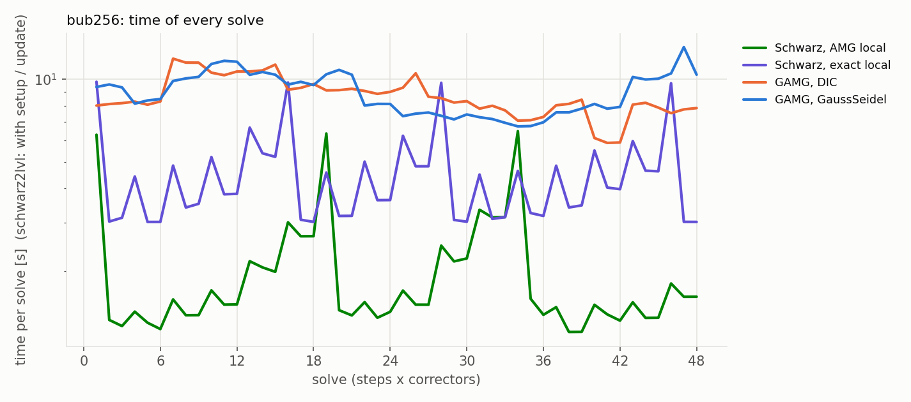

# GAMG reference: run_gamg_23038420

`NP=240 COARSE='--coarse-solver cpardiso --coarse-procs 48 --coarse-root-below 10000' BASE='--tau 0.3 --nev 8 --eig-tol 1e-4' STEPS_A=20 STEPS_B=16 CORR=3 N_A=192 N_B=256 NBUB=150 RADIUS=0.04 RHO=1000 CFL=0.5 SEED=2024 OpenFOAM=10`

`not a git checkout: see src_hash.txt sources md5: 816683acbf76`

## Checks

- test_bubbles: ALL PASSED
- matrix OpenFOAM vs generator (24^3, step 3): OK: matrices equal to 3.6e-15, right-hand sides to 1.0e-14 (relative to the largest entry; tolerance 1e-12)
- mesh: `N=192 NP=240 method=scotch mesh=0eab01e8 time=181s 2026-10-23 18:20:01`
- mesh: `N=256 NP=240 method=scotch mesh=0eab01e8 time=266s 2026-10-23 18:21:25`
- runs not ok: none
- solves: 492, converged 492, max true relative residual 1.10e-08

## Cost per solve

Every solve starts from 0. schwarz2lvl stops at ||b - Ax||_2 / ||b||_2 = 1e-8, OpenFOAM at its normalised L1 residual relTol (fvSolution: 1e-9, so that its 2-norm residual is also ~1e-8); *true res.* is ||b - Ax||_2 / ||b||_2 for both. *cost/solve* = total / solves (schwarz2lvl: setup and updates included); *median* = median cost of the solves after the first; *first* = first solve (schwarz2lvl: with the initial setup); **vs GAMG_GS** = cost/solve relative to GAMG with GaussSeidel (the usual OpenFOAM setup). Iterations: V-cycles (GAMG), CG / GMRES iterations.

### bub192

| variant | solver | its avg / max | true res. (max) | first [s] | median [s] | cost/solve [s] | total [s] | vs GAMG_GS |
|:--|:--|--:|--:|--:|--:|--:|--:|--:|
| amg | Schwarz, AMG local (2 rebuilds, 17 refact.) | 50.7 / 131 | 9.9e-09 | 16.7 | 0.550 | 1.031 | 61.9 | 0.38x |
| exact | Schwarz, exact local (3 rebuilds, 16 refact.) | 35.9 / 52 | 9.8e-09 | 2.894 | 1.097 | 1.225 | 73.5 | 0.45x |
| GAMG_DIC | GAMG, DIC | 139.1 / 182 | 8.6e-09 | 1.799 | 1.999 | 2.033 | 122 | 0.74x |
| GAMG_GS | GAMG, GaussSeidel | 212.2 / 315 | 1.1e-08 | 2.515 | 2.601 | 2.742 | 165 | 1.00x |
| PCG_GAMG | PCG + GAMG | 66.9 / 130 | 5.5e-09 | 3.470 | 5.224 | 5.347 | 321 | 1.95x |

Fastest OpenFOAM variant: **GAMG_DIC** (2.033 s per solve); best schwarz2lvl: **amg** (1.031 s per solve, 0.51x; steady-state median 0.27x).

### bub256

| variant | solver | its avg / max | true res. (max) | first [s] | median [s] | cost/solve [s] | total [s] | vs GAMG_GS |
|:--|:--|--:|--:|--:|--:|--:|--:|--:|
| amg | Schwarz, AMG local (2 rebuilds, 13 refact.) | 50.6 / 93 | 1.0e-08 | 6.275 | 1.512 | 2.041 | 98.0 | 0.23x |
| exact | Schwarz, exact local (3 rebuilds, 12 refact.) | 42.9 / 62 | 9.9e-09 | 9.785 | 3.824 | 4.518 | 217 | 0.50x |
| GAMG_DIC | GAMG, DIC | 270.8 / 357 | 1.0e-08 | 8.017 | 8.317 | 8.724 | 419 | 0.97x |
| GAMG_GS | GAMG, GaussSeidel | 367.1 / 477 | 1.0e-08 | 9.369 | 8.466 | 8.985 | 431 | 1.00x |

Fastest OpenFOAM variant: **GAMG_DIC** (8.724 s per solve); best schwarz2lvl: **amg** (2.041 s per solve, 0.23x; steady-state median 0.18x).

