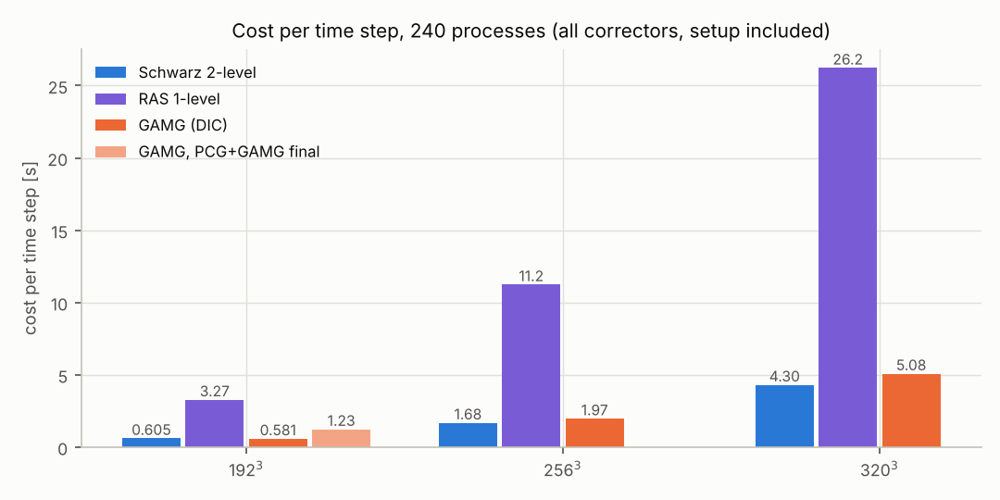
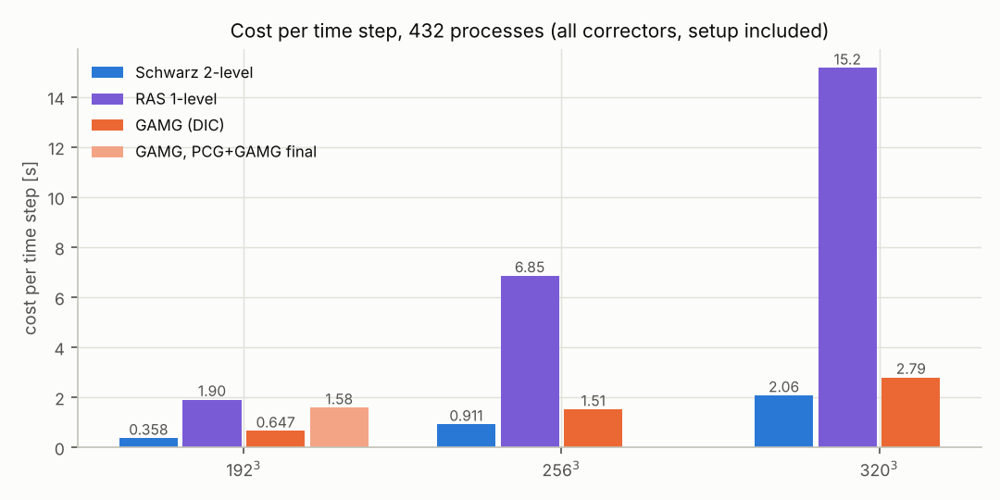
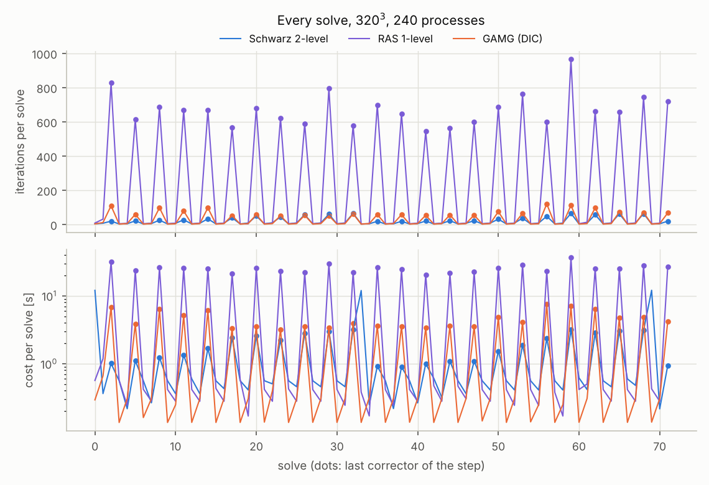
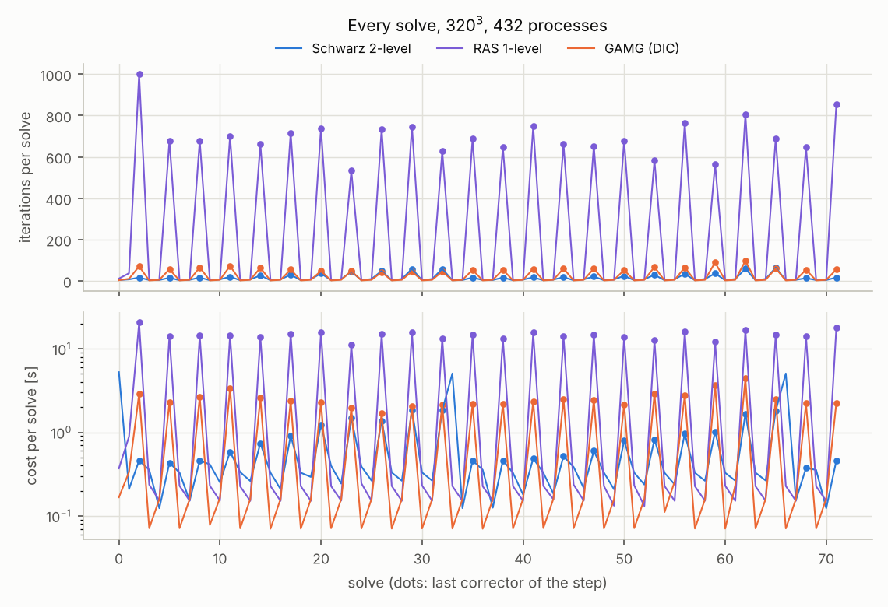

# Warm-start campaign: report

Runs: `run_warm_np240_23097350`, `run_warm_np432_23097354`.

Right-hand side **buoyancy**, every solve from the previous solution, correctors relTol 0.05 or tolerance 1e-7, last corrector of every step tolerance 1e-7 (relTol 0); 24 steps x 3 correctors; bubbles nb=150, R=0.04, rho ratio 1000, cfl 0.5.

## Checks

- `run_warm_np240_23097350` binaries: sources=729b64f0bbbf test_bubbles=passed matrix_check="OK: both sources (alpha, buoyancy), parallel assembly on 4 processes" 2026-10-27 17:24:09 test_warmstart=passed test_stopping=passed test_bicgstab=passed
- `run_warm_np240_23097350` matrix check: alpha: OK: matrices equal to 3.6e-15, right-hand sides to 1.0e-14 (relative to the largest entry; tolerance 1e-12) / buoyancy: OK: matrices equal to 3.6e-15, right-hand sides to 2.5e-15 (relative to the largest entry; tolerance 1e-12) / alpha, 4 processes: OK: 4 steps, rhs checksums serial / parallel differ by 5.4e-15 of sum|b| (tolerance 1e-12) / buoyancy, 4 processes: OK: 4 steps, rhs checksums serial / parallel differ by 8.1e-15 of sum|b| (tolerance 1e-12) / OK: both sources (alpha, buoyancy), parallel assembly on 4 processes
- `run_warm_np432_23097354` binaries: sources=729b64f0bbbf test_bubbles=passed matrix_check="OK: both sources (alpha, buoyancy), parallel assembly on 4 processes" 2026-10-27 17:24:09 test_warmstart=passed test_stopping=passed test_bicgstab=passed
- `run_warm_np432_23097354` matrix check: alpha: OK: matrices equal to 3.6e-15, right-hand sides to 1.0e-14 (relative to the largest entry; tolerance 1e-12) / buoyancy: OK: matrices equal to 3.6e-15, right-hand sides to 2.5e-15 (relative to the largest entry; tolerance 1e-12) / alpha, 4 processes: OK: 4 steps, rhs checksums serial / parallel differ by 5.4e-15 of sum|b| (tolerance 1e-12) / buoyancy, 4 processes: OK: 4 steps, rhs checksums serial / parallel differ by 8.1e-15 of sum|b| (tolerance 1e-12) / OK: both sources (alpha, buoyancy), parallel assembly on 4 processes
- runs: 20, all complete and converged: **no**
  - `bub320_s2l_1L` (run_warm_np432_23097354): status not_converged, 72 of 72 solves, 71 converged

## Cost per time step [s]

All correctors of a step, setup and updates included; *all*: the whole run / steps (the first step starts from 0 and carries the initial setup); *steady*: steps 1.. only. Ratio = best OpenFOAM variant / Schwarz variant (> 1: Schwarz faster).

| N | NP | Schwarz 2-level | RAS 1-level | GAMG (DIC) | GAMG, PCG+GAMG final | best OF / 2-level | best OF / 1-level |
|--:|--:|--:|--:|--:|--:|--:|--:|
| 192³ | 240 | 0.605 / 0.564 | 3.27 / 3.23 | 0.581 / 0.570 | 1.23 / 1.24 | **0.96×** / 1.01× (GAMG (DIC)) | **0.18×** / 0.18× (GAMG (DIC)) |
| 192³ | 432 | 0.358 / 0.339 | 1.90 / 1.91 | 0.647 / 0.643 | 1.58 / 1.55 | **1.81×** / 1.90× (GAMG (DIC)) | **0.34×** / 0.34× (GAMG (DIC)) |
| 256³ | 240 | 1.68 / 1.54 | 11.2 / 11.2 | 1.97 / 1.91 | - | **1.17×** / 1.24× (GAMG (DIC)) | **0.18×** / 0.17× (GAMG (DIC)) |
| 256³ | 432 | 0.911 / 0.851 | 6.85 / 6.69 | 1.51 / 1.49 | - | **1.66×** / 1.75× (GAMG (DIC)) | **0.22×** / 0.22× (GAMG (DIC)) |
| 320³ | 240 | 4.30 / 3.91 | 26.2 / 25.9 | 5.08 / 4.96 | - | **1.18×** / 1.27× (GAMG (DIC)) | **0.19×** / 0.19× (GAMG (DIC)) |
| 320³ | 432 | 2.06 / 1.90 | 15.2 / 14.9 (!) | 2.79 / 2.76 | - | **1.35×** / 1.46× (GAMG (DIC)) | **0.18×** / 0.19× (GAMG (DIC)) |

Each cell: all / steady. (!): run incomplete or not converged.

### Against the earlier setting (scaling campaign: alpha source, every solve from 0, relTol 1e-2)

| N | NP | GAMG / Schwarz, scaling campaign (cost per solve) | best OF / 2-level here (cost per step, all) |
|--:|--:|--:|--:|
| 192³ | 240 | 1.79× | 0.96× |
| 192³ | 432 | 2.73× | 1.81× |
| 256³ | 240 | 2.02× | 1.17× |
| 256³ | 432 | 2.59× | 1.66× |
| 320³ | 240 | 1.99× | 1.18× |
| 320³ | 432 | 2.44× | 1.35× |

## Iterations

Correctors / last corrector: average (min - max) per solve. *res0*: median initial normalised residual of the first corrector of the steps after the first (state of the warm start). *ms/it*: time of the iterations / iterations. *last*: share of the cost spent in the last correctors.

| N | NP | variant | correctors | last corrector | res0 | ms/it | last | final residual of the last correctors (max) |
|--:|--:|:--|--:|--:|--:|--:|--:|--:|
| 192³ | 240 | Schwarz 2-level | 4.2 (3 - 9) | 22.5 (12 - 41) | 2.9e-01 | 11.5 | 43% | 9.8e-08 |
| 192³ | 240 | RAS 1-level | 7.7 (3 - 25) | 418.8 (331 - 683) | 2.9e-01 | 7.40 | 94% | 1.0e-07 |
| 192³ | 240 | GAMG (DIC) | 3.1 (2 - 7) | 35.2 (25 - 45) | 2.9e-01 | 13.9 | 88% | 9.9e-08 |
| 192³ | 240 | GAMG, PCG+GAMG final | 3.1 (2 - 7) | 13.6 (9 - 24) | 2.9e-01 | 62.1 | 94% | 1.0e-07 |
| 192³ | 432 | Schwarz 2-level | 4.0 (3 - 9) | 19.3 (10 - 39) | 2.9e-01 | 7.97 | 41% | 9.7e-08 |
| 192³ | 432 | RAS 1-level | 7.7 (4 - 39) | 454.0 (353 - 555) | 2.9e-01 | 3.98 | 95% | 9.9e-08 |
| 192³ | 432 | GAMG (DIC) | 3.1 (2 - 6) | 33.8 (23 - 43) | 2.9e-01 | 16.1 | 93% | 1.0e-07 |
| 192³ | 432 | GAMG, PCG+GAMG final | 3.1 (2 - 6) | 13.2 (7 - 21) | 2.9e-01 | 81.2 | 97% | 9.7e-08 |
| 256³ | 240 | Schwarz 2-level | 4.6 (3 - 9) | 29.8 (15 - 66) | 3.2e-01 | 25.4 | 44% | 9.9e-08 |
| 256³ | 240 | RAS 1-level | 6.4 (4 - 42) | 579.3 (464 - 735) | 3.2e-01 | 18.8 | 97% | 1.0e-07 |
| 256³ | 240 | GAMG (DIC) | 3.3 (2 - 11) | 56.2 (42 - 85) | 3.2e-01 | 31.1 | 90% | 1.0e-07 |
| 256³ | 432 | Schwarz 2-level | 4.7 (3 - 9) | 24.0 (12 - 49) | 3.2e-01 | 16.3 | 42% | 9.9e-08 |
| 256³ | 432 | RAS 1-level | 6.4 (4 - 33) | 636.9 (476 - 993) | 3.2e-01 | 10.4 | 97% | 1.0e-07 |
| 256³ | 432 | GAMG (DIC) | 3.6 (2 - 10) | 53.0 (35 - 98) | 3.2e-01 | 25.0 | 92% | 9.9e-08 |
| 320³ | 240 | Schwarz 2-level | 5.1 (3 - 10) | 38.4 (18 - 65) | 3.6e-01 | 50.8 | 45% | 9.8e-08 |
| 320³ | 240 | RAS 1-level | 5.9 (3 - 31) | 672.2 (543 - 965) | 3.6e-01 | 37.9 | 97% | 1.0e-07 |
| 320³ | 240 | GAMG (DIC) | 3.6 (2 - 11) | 71.9 (51 - 120) | 3.6e-01 | 63.9 | 91% | 1.0e-07 |
| 320³ | 432 | Schwarz 2-level | 5.1 (3 - 9) | 30.5 (13 - 64) | 3.6e-01 | 30.2 | 44% | 9.9e-08 |
| 320³ | 432 | RAS 1-level | 6.2 (4 - 37) | 700.0 (533 - 1000) | 3.6e-01 | 21.1 | 97% | 7.9e-07 |
| 320³ | 432 | GAMG (DIC) | 3.6 (2 - 10) | 59.7 (42 - 97) | 3.6e-01 | 41.5 | 91% | 1.0e-07 |

## Schwarz: setup and phases

Per step [s]: initial setup (amortized), updates (rebuilds, refactorizations), and the iterations split with the timers of the log (local solves, coarse correction, Krylov).

| N | NP | variant | initial setup | updates | local solves | coarse corr. | Krylov | rebuilds (median [s]) | setup share |
|--:|--:|:--|--:|--:|--:|--:|--:|--:|--:|
| 192³ | 240 | Schwarz 2-level | 0.054 | 0.196 | 0.183 | 0.092 | 0.079 | 2 (1.27) | 41% |
| 192³ | 240 | RAS 1-level | 0.003 | 0.060 | 2.52 | 0.000 | 0.694 | 0 (-) | 2% |
| 192³ | 432 | Schwarz 2-level | 0.027 | 0.114 | 0.084 | 0.089 | 0.044 | 2 (0.656) | 39% |
| 192³ | 432 | RAS 1-level | 0.001 | 0.032 | 1.34 | 0.000 | 0.523 | 0 (-) | 2% |
| 256³ | 240 | Schwarz 2-level | 0.173 | 0.518 | 0.575 | 0.220 | 0.194 | 2 (4.08) | 41% |
| 256³ | 240 | RAS 1-level | 0.005 | 0.124 | 8.60 | 0.000 | 2.51 | 0 (-) | 1% |
| 256³ | 432 | Schwarz 2-level | 0.079 | 0.289 | 0.270 | 0.172 | 0.102 | 2 (1.90) | 40% |
| 256³ | 432 | RAS 1-level | 0.004 | 0.085 | 5.18 | 0.000 | 1.59 | 0 (-) | 1% |
| 320³ | 240 | Schwarz 2-level | 0.493 | 1.34 | 1.45 | 0.504 | 0.513 | 2 (11.8) | 43% |
| 320³ | 240 | RAS 1-level | 0.011 | 0.256 | 19.9 | 0.000 | 6.00 | 0 (-) | 1% |
| 320³ | 432 | Schwarz 2-level | 0.214 | 0.625 | 0.653 | 0.308 | 0.264 | 2 (4.95) | 41% |
| 320³ | 432 | RAS 1-level | 0.006 | 0.136 | 11.3 | 0.000 | 3.73 | 0 (-) | 1% |

## Plots

