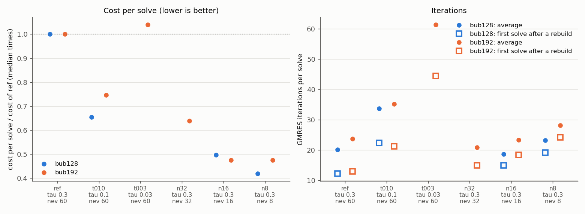
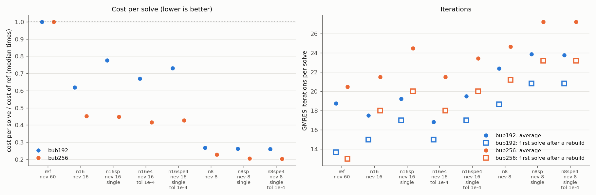

# Small coarse space (P5) on G100: results

Two jobs, same sources (P2, md5 `b41f63a702b7`), no code change, only existing options:

- `run_p5_23013515` (`Allrun_p5.sh`, 240 processes): number of coarse vectors per subdomain m_i
  (cap `--nev` or threshold `--tau`) at 128³ and 192³, and where to solve A_00 at 192³.
  Full tables: [`report.md`](run_p5_23013515/report.md).
- `run_p5b_23016038` (`Allrun_p5b.sh`, 960 processes): `--nev 16` / `8` alone, with single-precision
  factors of A_ii (`--local-precision single`) and with `--eig-tol 1e-4`, at 192³ and 256³.
  Full tables: [`report.md`](run_p5b_23016038/report.md).

All runs are bubbles3d time loops at rho 1000 (30 steps x 3 correctors, 24 steps at 256³),
`--reuse auto`, Cholesky (P2). `ref` = `--tau 0.3 --nev 60`, the setting of P1/P2. All 948 + 1296
solves converged (true residual <= 1e-8). Costs are compared with median times (robust to the
timing bursts of the network; they differ from the measured ones by less than 2% at 240 processes
and by up to 9% at 960).

## In short

| processes | problem | m_i (`ref`) | best variant | cost/solve `ref` -> best [s] | vs `ref` |
|--:|:--|--:|:--|--:|--:|
| 240 | 128³ (~9k cells per process) | 25 | `--nev 8` | 0.465 -> 0.195 | **-58%** |
| 240 | 192³ (~30k) | 52 | `--nev 16` or `8` | 2.089 -> 0.993 | **-52%** |
| 960 | 192³ (~7k) | 24 | `--nev 8` (+ single, tol 1e-4) | 1.327 -> 0.356 (0.345) | **-73%** (-74%) |
| 960 | 256³ (~17k) | 42 | `--nev 8` + single + tol 1e-4 | 3.056 -> 0.624 | **-80%** |

1. **A cap on `--nev` is the knob that works.** With m_i = 8-16 instead of 25-52 every coarse
   operation is cheaper (factorization of A_00 ~ m_i³, coarse solve ~ m_i², products with V ~ m_i),
   and Arnoldi computes only nev eigenpairs: a rebuild is 4-6x cheaper, so `auto` rebuilds more
   often and the average iterations stay close to `ref` (192³ at 240: 23.3 vs 23.7), although a
   fresh coarse space needs a few more (18 vs 13).
2. **A smaller τ is worse at the same m_i:** Arnoldi still computes 60 eigenpairs (rebuild ~10 s at
   192³), and with τ = 0.03 (m_i ~ 3) the iterations explode (61 on average, up to 107).
3. **At 960 processes the coarse solve decides.** When n0 = Σ m_i exceeds 10000, A_00 goes to
   cpardiso, whose solve takes 30-38 ms per iteration (84% of an iteration for `ref` at 192³). With
   `--nev 8`, n0 = 7680 stays on rank 0: 7 ms per iteration.
4. **Single precision pays only where the local solves are a large share and the coarse solve is
   small:** -9% at 256³ / 960 with `--nev 8`, -2% at 192³ / 960, no gain or a loss with
   `--nev 16` at 960 (coarse-dominated: each extra iteration costs a 30 ms coarse solve).
5. **`--eig-tol 1e-4` is free:** identical iterations after every rebuild (same coarse space),
   eigensolver -15% to -20% per setup; the total gain is small (up to 8%, often within the noise of
   the coarse solve) because the eigensolver is now a small part of the time.
6. **Strong scaling of 192³ from 240 to 960 processes** (cost per solve): `ref` 1.57x, `--nev 16`
   1.21x (cpardiso coarse solve), `--nev 8` **2.79x** (70% parallel efficiency).

## Plots

240 processes: relative cost and iterations of every variant (`t010` / `t003` = threshold τ 0.1 /
0.03, `n32` / `n16` / `n8` = cap on nev).

960 processes: `n16` / `n8` with single precision (`sp`) and `--eig-tol 1e-4` (`e4`).

Per-iteration time split. At 240 processes and 192³ the solves with the factors of A_ii are 60-70% of
an iteration once m_i is small; at 960 processes and 192³ the coarse solve is the largest item even
with `--nev 8` (7 of 13 ms); at 256³ / 960 the local solves (42%) and the coarse solve (30%) share it.

## Where to solve A_00 (240 processes, 192³, `ref`, n0 ~ 12600)

| coarse solver | coarse solve [ms/iteration] | A_00 refactorization [s] | cost/solve [s] |
|:--|--:|--:|--:|
| rank 0 | 28.8 | 1.16 | 2.42 |
| cpardiso, 5 leaders (one per node) | 19.8 | 0.84 | 2.25 |
| cpardiso, 20 leaders | **15.1** | 0.65 | 2.12 |
| cpardiso, 48 leaders | 15.7 | **0.56** | **2.10** |

One leader per node does not help: gathering inside the node does not make up for only 5 processes
in the distributed solve. 20 and 48 leaders are equivalent.

## Recommended settings for this kind of matrix (SPD, high contrast)

- `--tau 0.3 --nev 8` (or 16 with sub-domains of more than ~20k cells, where the coarse solve is
  cheap and the extra vectors save iterations), `--eig-tol 1e-4`.
- `--local-precision single` only with large sub-domains (>~15k cells) and a coarse solve on rank 0.
- The cap removes the guarantee of τ: a sub-domain crossed by more bubble pieces than nev loses
  modes, and a rebuild does not fix it. The number of iterations right after a rebuild is the
  signal to watch.

## Open points

1. **Coarse solve at high process counts.** On rank 0 it costs 1.2 ms per iteration at 240 processes
   (n0 1920) and 7 ms at 960 (n0 7680); cpardiso is worse at n0 ~ 15000 on 960 processes. The
   threshold `--coarse-root-below 10000` was measured at 240 processes with m_i 25-52: with m_i = 16
   the rank-0 solver may win beyond 10000 (`--nev 16` with rank 0 at 960 processes was not tested).
   The coarse timer does not separate gather, solve and scatter: finer timers would tell whether the
   cost is latency (960 ranks) or the factor.
2. **Local solves** are the largest item with large sub-domains (240 processes: 60-70% of an iteration
   at 192³; 960 processes: 42% at 256³): the target of P7 (inexact local solvers). At ~7k cells per
   process they are only ~25% of an iteration.
