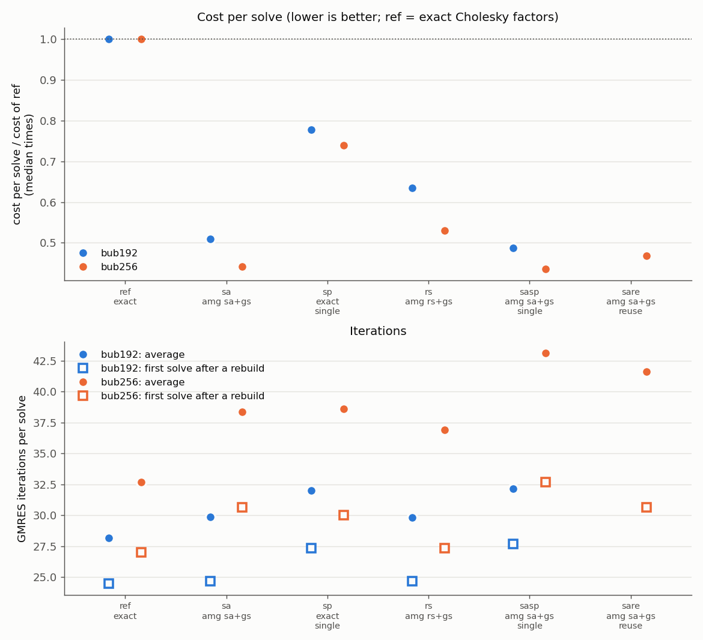
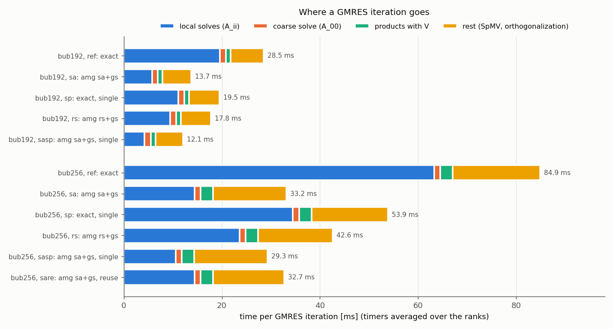
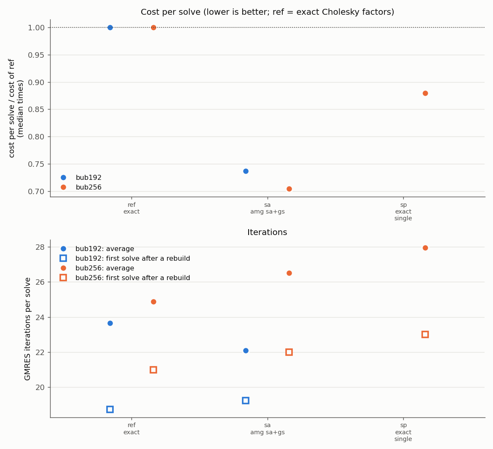
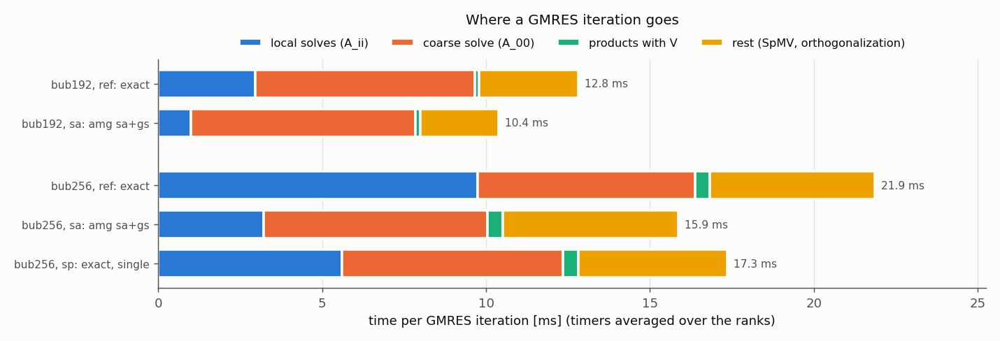

# Inexact local solvers (P7b) on G100: results

Two jobs, same sources (P7b, md5 `882d3a3ae513`), bubbles3d time loops (ρ ratio 1000, 150 bubbles,
3 correctors per step, `--reuse auto`), coarse space of P5 (`--tau 0.3 --nev 8 --eig-tol 1e-4`),
Ã_ii and A_00 always factorized exactly. Only the solver of A_ii in the one-level part changes:

- `run_p7b_23031088` (`Allrun_p7b.sh`, 240 processes): 192³ (~30k cells per process, 20 steps) and
  256³ (~70k cells per process, 16 steps). Full tables: [`report.md`](run_p7b_23031088/report.md).
- `run_p7b_23031087` (`Allrun_p7b_960.sh`, 960 processes): the same problems at ~7k and ~17k cells
  per process. Full tables: [`report.md`](run_p7b_23031087/report.md).

| variant | A_ii in the one-level part |
|:--|:--|
| `ref` | exact Cholesky (PARDISO), double |
| `sp` | exact Cholesky, single precision |
| `sa` | one AMG V-cycle, smoothed aggregation + Gauss-Seidel (defaults: coarsest level ≤ 500 unknowns, full AMG setup at every refactorization) |
| `rs` | the same with Ruge-Stuben coarsening |
| `sasp` | `sa` in float |
| `sare` | `sa` with the AMG hierarchy of the last rebuild reused in the refactorizations |

All 588 + 264 solves converged (true residual < 1e-8); `test_inexact` and `test_reuse` passed on
16 processes. Costs are compared within a job with median times (robust to the timing bursts of
the network); `ref` is the setting of P5.

## In short

| processes | problem | cells per process | cost/solve `ref` [s] | `sp` | **`sa`** | `sa` vs `sp` |
|--:|:--|--:|--:|--:|--:|--:|
| 960 | 192³ | ~7k | 0.376 | (not run) | **-26%** | – |
| 960 | 256³ | ~17k | 0.675 | -12% | **-30%** | -20% |
| 240 | 192³ | ~30k | 0.999 | -22% | **-49%** | -35% |
| 240 | 256³ | ~70k | 3.678 | -26% | **-56%** | -40% |

1. **One AMG V-cycle behaves like an exact local solve.** The first solve after a rebuild needs
   the same iterations as with exact factors (240 processes, 192³: 24.7 against 24.5; 960
   processes: 19.2 / 18.8 at 192³ and 22.0 / 21.0 at 256³): the V-cycle is spectrally equivalent
   to A_ii⁻¹ in practice, density ratio 1000 included. This is consistent with how the aggregates
   are built: they follow the strong (gas-gas) couplings, so the coarse AMG levels can represent
   the modes that are nearly constant inside each bubble, the low-energy modes of A_ii. Over a
   whole run the iterations grow by 6% (192³) and 17% (256³) at 240 processes, see point 6.
2. **Every GMRES iteration is 2-2.6x cheaper at 240 processes** (28.5 → 13.7 ms, 84.9 → 33.2 ms).
   The local solves are 3.4x (19.6 → 5.8 ms) and 4.4x (63.3 → 14.4 ms) cheaper: a solve with the
   exact factor reads nnz(L) twice (20-35 times nnz(A_ii), growing like n^(4/3)), a V-cycle reads
   ~1.5 nnz(A_ii) a few times, and both are limited by the memory bandwidth (48 ranks per node).
   The rest of the iteration shrinks too (6.7 → 5.8 ms, 17.8 → 15.0 ms): the exact solves take
   different times on different ranks (maximum minus mean over the run 2.6 s at 192³ and 7.9 s at
   256³, with AMG 0.6 s and 1.3 s), and the faster ranks waited in the next reduction of GMRES.
3. **The setup is cheaper**: refactorization of A_ii at every time step 0.18 → 0.05 s (192³) and
   0.94 → 0.11 s (256³, a full AMG setup against a numerical Cholesky factorization); A_ii at a
   rebuild 0.47 → 0.06 s and 1.83 → 0.12 s.
4. **The gain grows with the subdomain size**: -26% / -30% at 7k / 17k cells per process, -49% /
   -56% at 30k / 70k, because the exact factors cost more than linearly in n and AMG linearly. At
   960 processes the coarse solve (A_00 on rank 0, n0 = 7680) takes 6.7-6.9 ms per iteration,
   43-66% of an iteration with AMG, and caps the gain. With ≤ 500 unknowns on the coarsest level
   the 17k-cell subdomains get a 3-level hierarchy: AMG setup 0.04 s against 0.27 s for the exact
   Cholesky factorization, V-cycle 3.2 ms against 9.7 ms for the exact solve.
5. **Exact factors in single precision** (`sp`) give -12% to -26%: AMG beats them by 20-40%
   everywhere.
6. **Reusing the AMG hierarchy is worse** (`sare`, 256³): 41.6 iterations per solve against 38.4,
   cost -53% against -56%, although each refactorization is cheaper (0.16 against 0.20 s). After a
   rebuild the iterations grow faster from step to step (30 32 37 46 56 against 30 29 31 36 50):
   the aggregates and the prolongation P were built where the bubbles were; the bubbles rise by
   half a cell per step, and after 3-4 steps the aggregates across the interfaces no longer
   represent the bubble modes. A full AMG setup costs only 0.05-0.11 s, hence the default.
7. **Ruge-Stuben** (`rs`): same iterations as `sa` at 192³ (29.8 / 29.9), fewer at 256³ (36.9 /
   38.4, and 27.3 after a rebuild, as the exact solves), cheap setup (0.08 / 0.21 s), but the
   V-cycle costs 1.6x that of `sa` (operator complexity 2.8 against 1.6): -37% / -47%. The robust
   alternative for harder coefficients, not the default.
8. **AMG in float** (`sasp`): -51% / -56%, the same as `sa` within the noise (V-cycle 25-30%
   cheaper, 2-5 more iterations, as for any preconditioner in single precision at rtol 1e-8).
9. **Reuse policy**: no run stopped rebuilding. The iterations per decade stayed below 2.9 times
   the value after a rebuild in every run, so the `--rebuild-growth 4` safety net never
   triggered; no timing stall occurred in these jobs.
10. **Strong scaling 240 → 960 processes** (cost per solve): `sa` 1.84x at 192³ and 3.42x at 256³,
    `ref` 2.66x and 5.45x (superlinear: each exact factor shrinks faster than its subdomain). AMG
    scales less because it removes the part that shrank superlinearly and the coarse solve, which
    does not shrink, weighs more; in absolute terms it is the fastest at every size.

## Plots

240 processes: cost relative to `ref` and iterations (average over the run, first solve after a
rebuild) of every variant.

240 processes: with AMG the local solves are no longer the largest item; the rest (SpMV, GMRES
orthogonalization, waiting in the reductions) is now as large.

960 processes: cost relative to `ref` and iterations.

960 processes: the coarse solve dominates.

## Setup and iteration costs (240 processes)

| | 192³ `ref` | 192³ `sa` | 256³ `ref` | 256³ `sa` |
|:--|--:|--:|--:|--:|
| iterations per solve (average / after a rebuild) | 28.2 / 24.5 | 29.9 / 24.7 | 32.7 / 27.0 | 38.4 / 30.7 |
| AMG levels / operator complexity | – | 3 / 1.56 | – | 4 / 1.58 |
| time per iteration [ms] | 28.5 | 13.7 | 84.9 | 33.2 |
| of which local solves [ms] | 19.6 | 5.8 | 63.3 | 14.4 |
| A_ii refactorization per step [s] | 0.18 | 0.05 | 0.94 | 0.11 |
| eigensolver per rebuild [s] | 1.18 | 1.19 | 3.92 | 3.94 |
| rebuild (full setup) [s] | 1.93 | 1.57 | 6.68 | 4.98 |

At 256³ the first solve after a rebuild needs ~3.7 more iterations with AMG than with exact solves
(30.7 against 27.0), while at 192³ they are equal: with 70k cells and ≤ 500 unknowns on the coarsest
level the hierarchy has 4 levels, and its coarse correction is slightly weaker. For very large
subdomains a larger `--amg-coarse-enough` (1000-2000) may pay off; not measured.

## Recommended settings (SPD pressure, high density ratio)

- `--local-approx amg` with the defaults (`sa`, one Gauss-Seidel sweep, coarsest ≤ 500 unknowns,
  full setup at every refactorization), double precision, `--tau 0.3 --nev 8 --eig-tol 1e-4`.
- `--amg-coarsening rs` when `sa` needs clearly more iterations than the exact solves.

## Open points

1. **Eigensolver**: Ã_ii is still factorized exactly, 3.9 of the 5.0 s of a rebuild at 256³ with
   AMG (1.2 of 1.6 s at 192³). An eigensolver preconditioned by AMG (e.g. LOBPCG) would remove it.
2. **GMRES orthogonalization** (CGS2, three reductions per iteration, waiting included): 3.3 ms of
   13.7 at 192³ and 8.8 ms of 33.2 at 256³, ~25% of an iteration with AMG, memory-bound. One
   Gram-Schmidt pass with a selective second pass would roughly halve it.
3. **Coarse solve at 960 processes** (6.7-6.9 ms per iteration, rank 0, n0 = 7680): the multilevel
   extension (P8) or a faster distributed coarse solve.
