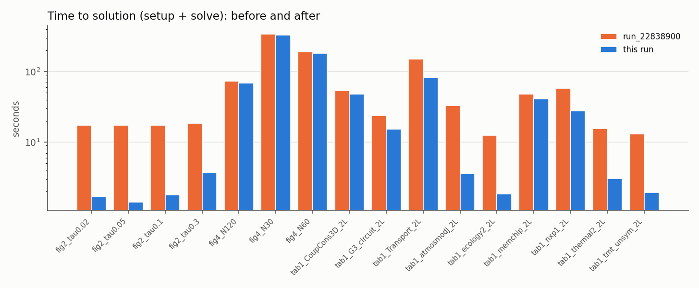
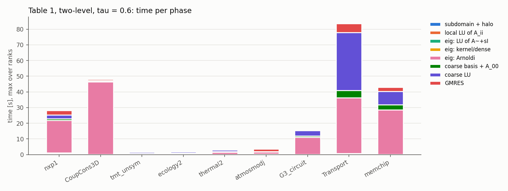
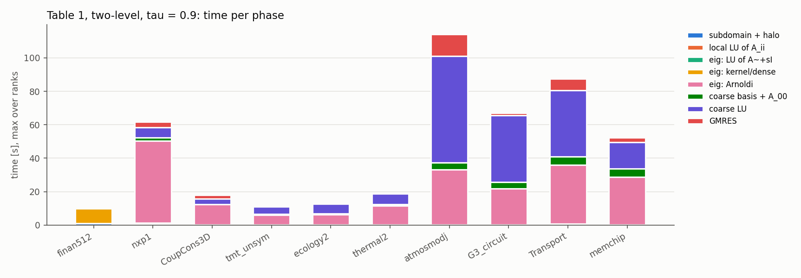
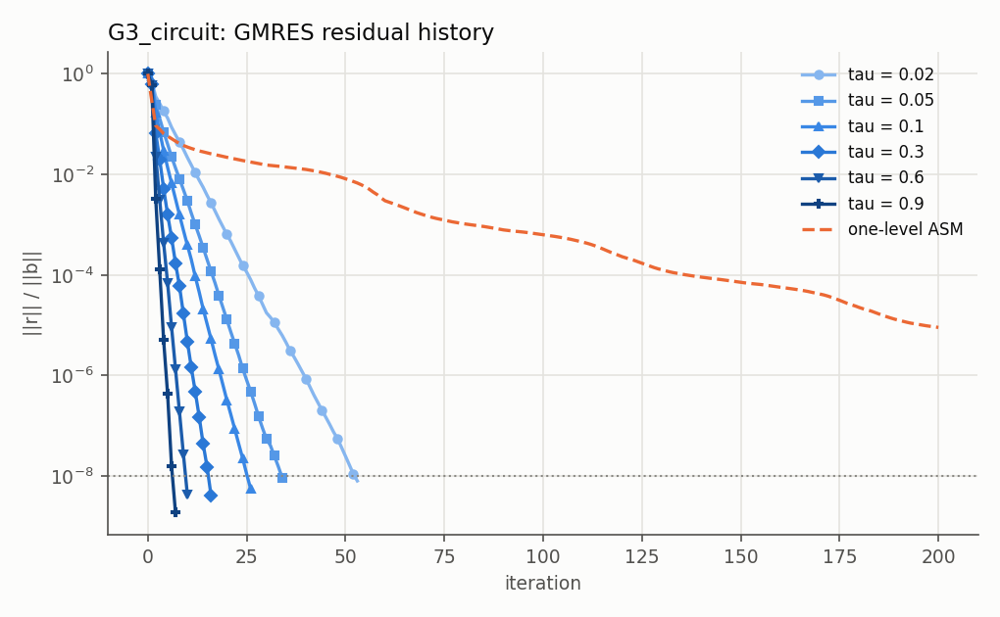
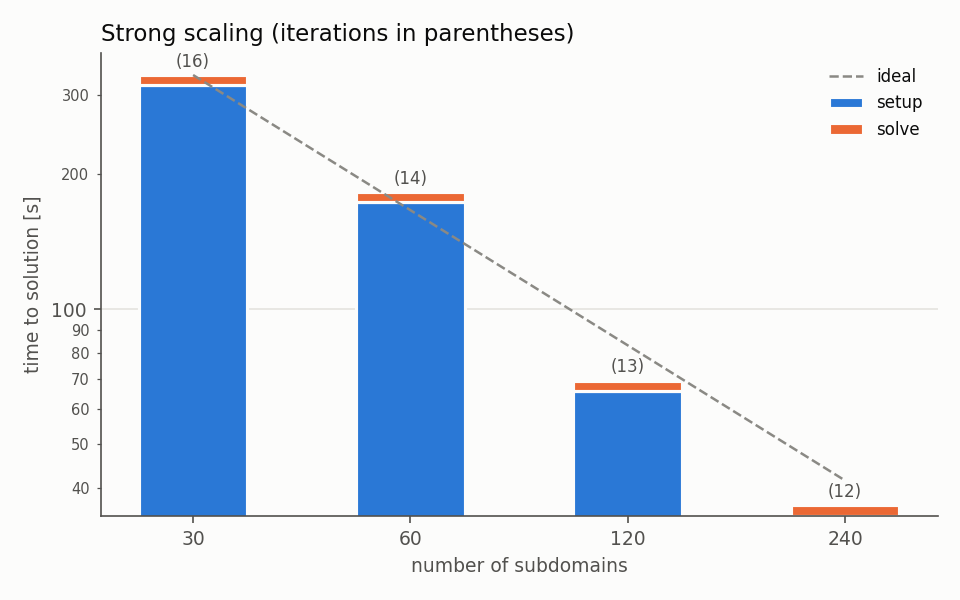
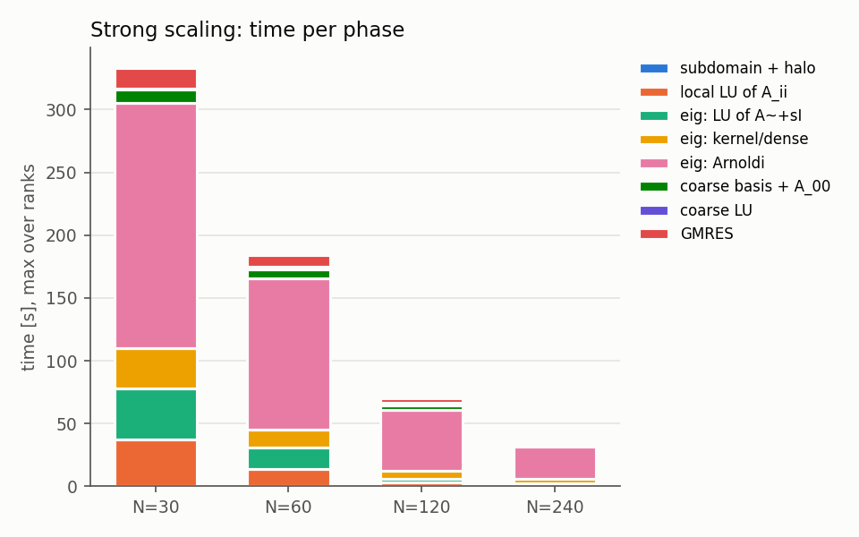
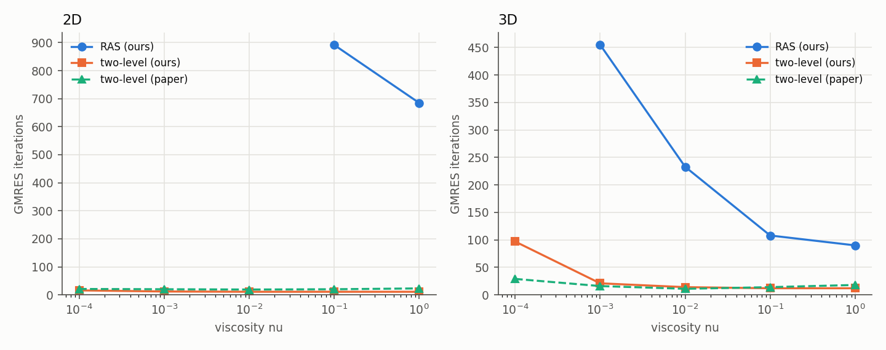

# schwarz2lvl vs Al Daas, Jolivet, Rees (SISC 2023)

Run directory `run_22843541`.

## Runs

- `test_subdomain` (16 processes): **ALL PASSED**
- `test_preconditioner` (16 processes): **ALL PASSED**
- git: `0d70f9f Readme Updates Ready for cineca testing`
- modules: `Currently Loaded Modulefiles: 1) profile/base(default) 2) cintools/1.0 3) profile/eng 4) autoload 5) intel/oneapi-2021--binary <aL> 6) intelmpi/oneapi-2021--binary <aL> 7) boost/1.76.0--intelmpi--oneapi-2021--binary <aL> 8) fftw/3.3.9--intelmpi--oneapi-2021--binary <aL> 9) openfoam/10 10) metis/5.1.0--gcc--10.2.0 11) intel-oneapi-mkl/2023.2.0 Key: (symbolic-version) <module-tag> <aL>=auto-loaded`

| run | np | status | its | true res. | n0 | setup [s] | solve [s] | wall [s] | error |
|:--|--:|:--|--:|--:|--:|--:|--:|--:|:--|
| fig2_ASM | 240 | not_converged | n.c. (200) | 9.1e-06 |  | 0.09 | 0.77 | 11 |  |
| fig2_tau0.02 | 240 | ok | 53 | 8.0e-09 | 853 | 0.79 | 0.89 | 9 |  |
| fig2_tau0.05 | 240 | ok | 34 | 9.2e-09 | 1936 | 0.81 | 0.60 | 9 |  |
| fig2_tau0.1 | 240 | ok | 26 | 5.6e-09 | 3545 | 1.30 | 0.47 | 12 |  |
| fig2_tau0.3 | 240 | ok | 16 | 4.1e-09 | 10052 | 3.25 | 0.39 | 13 |  |
| fig4_N120 | 120 | ok | 13 | 6.6e-09 | 7126 | 65.7 | 3.61 | 86 |  |
| fig4_N240 | 240 | ok | 12 | 5.4e-09 | 12827 | 34.7 | 1.92 | 56 |  |
| fig4_N30 | 30 | ok | 16 | 7.7e-09 | 1805 | 316 | 16.1 | 346 |  |
| fig4_N60 | 60 | ok | 14 | 7.6e-09 | 3616 | 173 | 8.92 | 199 |  |
| tab1_CoupCons3D_2L | 240 | ok | 23 | 6.5e-09 | 6968 | 47.1 | 0.73 | 61 |  |
| tab1_CoupCons3D_2L_t0.9 | 240 | ok | 21 | 4.6e-09 | 23422 | 15.6 | 2.11 | 30 |  |
| tab1_CoupCons3D_RAS | 240 | ok | 23 | 5.3e-09 |  | 0.14 | 0.13 | 14 |  |
| tab1_G3_circuit_2L | 240 | ok | 10 | 4.3e-09 | 25473 | 14.9 | 0.43 | 23 |  |
| tab1_G3_circuit_2L_t0.9 | 240 | ok | 7 | 1.9e-09 | 66910 | 64.0 | 1.33 | 72 |  |
| tab1_G3_circuit_RAS | 240 | not_converged | n.c. (200) | 2.0e-06 |  | 0.09 | 0.89 | 10 |  |
| tab1_Transport_2L | 240 | ok | 8 | 7.3e-09 | 65475 | 75.8 | 5.78 | 97 |  |
| tab1_Transport_2L_t0.9 | 240 | ok | 8 | 6.2e-09 | 72000 | 80.2 | 6.72 | 102 |  |
| tab1_Transport_RAS | 240 | not_converged | n.c. (200) | 2.5e-04 |  | 0.23 | 4.43 | 23 |  |
| tab1_atmosmodj_2L | 240 | ok | 71 | 9.4e-09 | 401 | 1.90 | 1.68 | 12 |  |
| tab1_atmosmodj_2L_t0.9 | 240 | ok | 14 | 5.8e-09 | 68736 | 99.3 | 13.1 | 122 |  |
| tab1_atmosmodj_RAS | 240 | ok | 79 | 9.3e-09 |  | 0.11 | 0.63 | 10 |  |
| tab1_circuit5M_dc_2L | 240 | timeout | T/O |  |  |  |  | 1200 |  |
| tab1_circuit5M_dc_RAS | 240 | ok | 10 | 6.5e-09 |  | 0.12 | 0.05 | 15 |  |
| tab1_ecology2_2L | 240 | ok | 8 | 1.6e-09 | 13380 | 1.67 | 0.18 | 8 |  |
| tab1_ecology2_2L_t0.9 | 240 | ok | 5 | 1.5e-09 | 31176 | 12.3 | 0.27 | 19 |  |
| tab1_ecology2_RAS | 240 | not_converged | n.c. (200) | 1.6e-03 |  | 0.07 | 0.35 | 7 |  |
| tab1_finan512_2L | 240 | error | ERR |  |  |  |  | 18 |  |
| tab1_finan512_2L_t0.9 | 240 | ok | 6 | 4.1e-10 | 5309 | 10.5 | 0.33 | 16 |  |
| tab1_finan512_RAS | 240 | ok | 6 | 2.8e-09 |  | 1.40 | 0.01 | 7 |  |
| tab1_memchip_2L | 240 | ok | 13 | 4.8e-09 | 39472 | 38.4 | 2.70 | 52 |  |
| tab1_memchip_2L_t0.9 | 240 | ok | 8 | 2.5e-09 | 53702 | 46.6 | 2.96 | 61 |  |
| tab1_memchip_RAS | 240 | ok | 44 | 6.5e-09 |  | 0.09 | 0.20 | 12 |  |
| tab1_nxp1_2L | 240 | ok | 42 | 7.0e-09 | 14060 | 24.9 | 2.79 | 33 |  |
| tab1_nxp1_2L_t0.9 | 240 | ok | 29 | 4.4e-09 | 22832 | 57.4 | 3.43 | 68 |  |
| tab1_nxp1_RAS | 240 | not_converged | n.c. (200) | 4.6e-05 |  | 0.66 | 1.93 | 10 |  |
| tab1_thermal2_2L | 240 | ok | 7 | 6.2e-09 | 16251 | 2.81 | 0.23 | 11 |  |
| tab1_thermal2_2L_t0.9 | 240 | ok | 5 | 1.0e-09 | 33435 | 18.3 | 0.29 | 26 |  |
| tab1_thermal2_RAS | 240 | not_converged | n.c. (200) | 1.9e-03 |  | 0.10 | 0.60 | 9 |  |
| tab1_tmt_unsym_2L | 240 | ok | 8 | 1.6e-09 | 13075 | 1.58 | 0.34 | 9 |  |
| tab1_tmt_unsym_2L_t0.9 | 240 | ok | 5 | 1.5e-09 | 30620 | 10.7 | 0.70 | 18 |  |
| tab1_tmt_unsym_RAS | 240 | not_converged | n.c. (200) | 4.7e-03 |  | 0.07 | 0.31 | 8 |  |
| tab2_2d_nu1_2L | 240 | ok | 11 | 4.3e-09 | 7443 | 1.48 | 0.34 | 8 |  |
| tab2_2d_nu1_RAS | 240 | ok | 685 | 8.6e-09 |  | 0.08 | 1.95 | 9 |  |
| tab2_2d_nu1e-1_2L | 240 | ok | 11 | 4.3e-09 | 7445 | 1.50 | 0.33 | 8 |  |
| tab2_2d_nu1e-1_RAS | 240 | ok | 892 | 9.9e-09 |  | 0.07 | 2.52 | 9 |  |
| tab2_2d_nu1e-2_2L | 240 | ok | 11 | 4.4e-09 | 7378 | 1.27 | 0.32 | 8 |  |
| tab2_2d_nu1e-2_RAS | 240 | not_converged | n.c. (1000) | 5.7e-08 |  | 0.08 | 3.00 | 10 |  |
| tab2_2d_nu1e-3_2L | 240 | ok | 12 | 4.0e-09 | 6545 | 1.25 | 0.33 | 8 |  |
| tab2_2d_nu1e-3_RAS | 240 | not_converged | n.c. (1000) | 1.6e-05 |  | 0.08 | 3.00 | 10 |  |
| tab2_2d_nu1e-4_2L | 240 | ok | 16 | 3.9e-09 | 3493 | 1.28 | 0.38 | 8 |  |
| tab2_2d_nu1e-4_RAS | 240 | not_converged | n.c. (1000) | 3.0e-04 |  | 0.07 | 3.24 | 10 |  |
| tab2_3d_nu1_2L | 240 | ok | 12 | 7.7e-09 | 2524 | 0.70 | 0.26 | 8 |  |
| tab2_3d_nu1_RAS | 240 | ok | 90 | 9.5e-09 |  | 0.73 | 0.20 | 6 |  |
| tab2_3d_nu1e-1_2L | 240 | ok | 12 | 7.6e-09 | 2514 | 0.74 | 0.27 | 14 |  |
| tab2_3d_nu1e-1_RAS | 240 | ok | 108 | 9.4e-09 |  | 0.06 | 0.20 | 7 |  |
| tab2_3d_nu1e-2_2L | 240 | ok | 14 | 2.9e-09 | 2341 | 0.75 | 0.32 | 7 |  |
| tab2_3d_nu1e-2_RAS | 240 | ok | 233 | 9.6e-09 |  | 0.73 | 0.42 | 7 |  |
| tab2_3d_nu1e-3_2L | 240 | ok | 21 | 6.6e-09 | 1304 | 0.74 | 0.43 | 7 |  |
| tab2_3d_nu1e-3_RAS | 240 | ok | 455 | 9.9e-09 |  | 0.07 | 0.98 | 7 |  |
| tab2_3d_nu1e-4_2L | 240 | ok | 97 | 8.9e-09 | 710 | 0.80 | 2.04 | 10 |  |
| tab2_3d_nu1e-4_RAS | 240 | not_converged | n.c. (1000) | 1.4e-05 |  | 0.81 | 1.76 | 8 |  |

`*` = GMRES reports convergence but the recomputed true residual is above 2 rtol; n.c. = not converged within maxit; T/O = stopped by RUN_TIMEOUT; killed = the job ended during the run.

## Changes with respect to `run_22838900`

Same run names, before -> after (max over ranks, seconds). With the adaptive eigensolver and an exact coarse solver n0 and iterations must not change: **!** flags a difference.

| run | its | n0 |  | Arnoldi | A_00 factorization | setup | solve | total |
|:--|--:|--:|--:|--:|--:|--:|--:|--:|
| fig2_tau0.02 | 53 | 853 |  | 16.8 -> 0.50 | 0.02 -> 0.09 | 17.0 -> 0.79 | 0.27 -> 0.89 | 17.3 -> 1.68 |
| fig2_tau0.05 | 34 | 1936 |  | 16.8 -> 0.50 | 0.05 -> 0.09 | 17.1 -> 0.81 | 0.22 -> 0.60 | 17.3 -> 1.41 |
| fig2_tau0.1 | 26 | 3545 |  | 16.8 -> 0.91 | 0.13 -> 0.15 | 17.2 -> 1.30 | 0.23 -> 0.47 | 17.4 -> 1.77 |
| fig2_tau0.3 | 16 | 10052 |  | 16.8 -> 2.28 | 0.80 -> 0.60 | 17.9 -> 3.25 | 0.53 -> 0.39 | 18.4 -> 3.64 |
| fig4_N120 | 13 | 7126 |  | 51.3 -> 48.5 | 2.66 -> 2.43 | 69.3 -> 65.7 | 3.90 -> 3.61 | 73.2 -> 69.3 |
| fig4_N240 | ERR -> 12 | - -> 12827 | **!** | - -> 25.4 | - -> 2.37 | - -> 34.7 | - -> 1.92 | - -> 36.6 |
| fig4_N30 | 16 | 1805 |  | 204 -> 195 | 0.91 -> 0.92 | 328 -> 316 | 16.7 -> 16.1 | 345 -> 332 |
| fig4_N60 | 14 | 3616 |  | 128 -> 120 | 2.42 -> 2.16 | 182 -> 173 | 9.37 -> 8.92 | 192 -> 182 |
| tab1_CoupCons3D_2L | 23 | 6968 |  | 51.8 -> 46.3 | 0.54 -> 0.59 | 52.6 -> 47.1 | 0.68 -> 0.73 | 53.3 -> 47.8 |
| tab1_G3_circuit_2L | 10 | 25473 |  | 16.8 -> 10.9 | 4.62 -> 3.37 | 21.9 -> 14.9 | 1.76 -> 0.43 | 23.7 -> 15.3 |
| tab1_Transport_2L | 8 | 65475 |  | 28.5 -> 35.6 | 103 -> 36.9 | 135 -> 75.8 | 15.0 -> 5.78 | 150 -> 81.6 |
| tab1_atmosmodj_2L | 71 | 401 |  | 31.9 -> 1.50 | 0.01 -> 0.03 | 32.3 -> 1.90 | 0.65 -> 1.68 | 33.0 -> 3.57 |
| tab1_ecology2_2L | 8 | 13380 |  | 10.1 -> 0.72 | 1.17 -> 0.76 | 12.0 -> 1.67 | 0.50 -> 0.18 | 12.5 -> 1.85 |
| tab1_finan512_2L | 6 -> ERR | 109 -> - | **!** | - | 0.00 -> - | 9.13 -> - | 0.01 -> - | 9.14 -> - |
| tab1_memchip_2L | 13 | 39472 |  | 28.7 -> 28.4 | 13.0 -> 8.58 | 43.1 -> 38.4 | 5.21 -> 2.70 | 48.4 -> 41.1 |
| tab1_nxp1_2L | 42 | 14060 |  | 48.7 -> 20.6 | 3.45 -> 2.47 | 54.0 -> 24.9 | 4.35 -> 2.79 | 58.3 -> 27.7 |
| tab1_thermal2_2L | 7 | 16251 |  | 12.8 -> 1.48 | 1.59 -> 1.06 | 14.9 -> 2.81 | 0.58 -> 0.23 | 15.5 -> 3.04 |
| tab1_tmt_unsym_2L | 8 | 13075 |  | 11.4 -> 0.55 | 1.08 -> 0.83 | 12.7 -> 1.58 | 0.47 -> 0.34 | 13.1 -> 1.93 |
| tab2_2d_nu1_2L | 11 | 7443 |  | 0.75 -> 0.73 | 0.35 -> 0.33 | 1.42 -> 1.48 | 0.25 -> 0.34 | 1.67 -> 1.82 |
| tab2_2d_nu1e-1_2L | 11 | 7445 |  | 0.74 -> 0.73 | 0.35 -> 0.36 | 1.43 -> 1.50 | 0.26 -> 0.33 | 1.69 -> 1.83 |
| tab2_2d_nu1e-2_2L | 11 | 7378 |  | 0.73 -> 0.71 | 0.34 -> 0.32 | 1.31 -> 1.27 | 0.25 -> 0.32 | 1.56 -> 1.60 |
| tab2_2d_nu1e-3_2L | 12 | 6545 |  | 0.77 -> 0.74 | 0.28 -> 0.27 | 1.30 -> 1.25 | 0.23 -> 0.33 | 1.53 -> 1.58 |
| tab2_2d_nu1e-4_2L | 16 | 3493 |  | 0.95 -> 0.92 | 0.10 -> 0.13 | 1.30 -> 1.28 | 0.13 -> 0.38 | 1.43 -> 1.66 |
| tab2_3d_nu1_2L | 12 | 2524 |  | 0.44 -> 0.45 | 0.09 -> 0.11 | 1.49 -> 0.70 | 0.10 -> 0.26 | 1.59 -> 0.96 |
| tab2_3d_nu1e-1_2L | 12 | 2514 |  | 0.45 -> 0.43 | 0.09 -> 0.11 | 0.72 -> 0.74 | 0.10 -> 0.27 | 0.83 -> 1.01 |
| tab2_3d_nu1e-2_2L | 14 | 2341 |  | 0.45 -> 0.44 | 0.09 -> 0.11 | 0.71 -> 0.75 | 0.16 -> 0.32 | 0.88 -> 1.08 |
| tab2_3d_nu1e-3_2L | 21 | 1304 |  | 0.50 | 0.03 -> 0.07 | 0.71 -> 0.74 | 0.17 -> 0.43 | 0.88 -> 1.18 |
| tab2_3d_nu1e-4_2L | 97 | 710 |  | 0.59 -> 0.58 | 0.01 -> 0.05 | 1.55 -> 0.80 | 0.29 -> 2.04 | 1.85 -> 2.84 |

## Table 1 - SuiteSparse matrices (nev = 300)

Ours: N = 240 subdomains, RAS = one-level, 2L = RAS + deflated coarse correction (2.4) at tau = 0.6, 0.9. Paper: N = 256, tau = 0.6; AMG columns = AGMG / BoomerAMG / GAMG (F = failure, C = complex). Compare n0/N, since N differs. In the paper the G3_circuit row (8 it., n0 = 71,385) is the tau = 0.9 point of its Fig. 2, not tau = 0.6 (11 it., n0 = 34,402).

| matrix | n | N | RAS its | 2L its tau=0.6 | n0/N tau=0.6 | 2L its tau=0.9 | n0/N tau=0.9 | paper its | paper n0/N | paper AMG its | 2L setup tau=0.6 [s] | 2L setup tau=0.9 [s] |
|:--|--:|--:|--:|--:|--:|--:|--:|--:|--:|--:|--:|--:|
| finan512 | 74752 | 240 | 6 | ERR |  | 6 | 22 | 6 | 10 | 9/7/8 |  | 10.5 |
| nxp1 | 414604 | 240 | n.c. (200) | 42 | 59 | 29 | 95 | 20 | 77 | F/F/F | 24.9 | 57.4 |
| CoupCons3D | 416800 | 240 | 23 | 23 | 29 | 21 | 98 | 20 | 113 | >100/F/26 | 47.1 | 15.6 |
| tmt_unsym | 917825 | 240 | n.c. (200) | 8 | 54 | 5 | 128 | 6 | 129 | 23/13/18 | 1.58 | 10.7 |
| ecology2 | 999999 | 240 | n.c. (200) | 8 | 56 | 5 | 130 | 6 | 133 | 18/12/18 | 1.67 | 12.3 |
| thermal2 | 1228045 | 240 | n.c. (200) | 7 | 68 | 5 | 139 | 26 | 157 | 18/14/20 | 2.81 | 18.3 |
| atmosmodj | 1270432 | 240 | 79 | 71 | 2 | 14 | 286 | 7 | 298 | F/8/17 | 1.90 | 99.3 |
| G3_circuit | 1585478 | 240 | n.c. (200) | 10 | 106 | 7 | 279 | 8 | 279 | 25/12/35 | 14.9 | 64.0 |
| Transport | 1602111 | 240 | n.c. (200) | 8 | 273 | 8 | 300 | 9 | 300 | 18/10/98 | 75.8 | 80.2 |
| memchip | 2707524 | 240 | 44 | 13 | 164 | 8 | 224 | 36 | 226 | F/15/F | 38.4 | 46.6 |
| circuit5M_dc | 3523317 | 240 | 10 | T/O |  |  |  | 7 | 34 | F/5/>100 |  |  |

## Fig. 2 - G3_circuit, influence of tau (nev = 300)

| tau | n0 | its | paper n0 | paper its | setup [s] | solve [s] |
|:--|--:|--:|--:|--:|--:|--:|
| 0.02 | 853 | 53 | 739 | 75 | 0.79 | 0.89 |
| 0.05 | 1936 | 34 | 1831 | 44 | 0.81 | 0.60 |
| 0.1 | 3545 | 26 | 3608 | 31 | 1.30 | 0.47 |
| 0.3 | 10052 | 16 | 11784 | 18 | 3.25 | 0.39 |
| 0.6 | 25473 | 10 | 34402 | 11 | 14.9 | 0.43 |
| 0.9 | 66910 | 7 | 71385 | 8 | 64.0 | 1.33 |
| one-level ASM | - | n.c. (200) | - | no conv. | 0.09 | 0.77 |

## Fig. 4 - strong scaling, 3D convection-diffusion, nu = 1e-2 (tau = 0.3, nev = 60)

Ours: convdiff3d 200x200x200 nu=0.01 (n=8000000, nnz=55760000). Paper: n = 8.1e6 (P2 elements), iterations 28, 21, 19, 20, 15 for N = 32, 64, 128, 256, 512. Speedup and efficiency relative to N = 30.

| N | n_I avg | n0 | its | paper its | setup [s] | solve [s] | total [s] | speedup | efficiency |
|:--|--:|--:|--:|--:|--:|--:|--:|--:|--:|
| 30 | 266667 | 1805 | 16 |  | 316 | 16.1 | 332 | 30.0 | 1.00 |
| 60 | 133333 | 3616 | 14 |  | 173 | 8.92 | 182 | 54.7 | 0.91 |
| 120 | 66667 | 7126 | 13 |  | 65.7 | 3.61 | 69.3 | 143.9 | 1.20 |
| 240 | 33333 | 12827 | 12 |  | 34.7 | 1.92 | 36.6 | 272.2 | 1.13 |

## Table 2 - convection-diffusion (4.1), nu = 1 ... 1e-4 (tau = 0.3, nev = 60)

Ours: finite volumes with upwind, N = 240, ~6k unknowns per subdomain in 2D and ~2k in 3D. Paper: SUPG finite elements, same subdomain sizes, N = 1024 (2D) and 4096 (3D). Compare iterations and n0/N.

| dim | nu | RAS its | 2L its | n0 | n0/N | paper its | paper n0/N | 2L setup [s] | 2L solve [s] |
|:--|--:|--:|--:|--:|--:|--:|--:|--:|--:|
| 2D | 1 | 685 | 11 | 7443 | 31 | 23 | 52 | 1.48 | 0.34 |
| 2D | 0.1 | 892 | 11 | 7445 | 31 | 20 | 52 | 1.50 | 0.33 |
| 2D | 0.01 | n.c. (1000) | 11 | 7378 | 31 | 19 | 52 | 1.27 | 0.32 |
| 2D | 0.001 | n.c. (1000) | 12 | 6545 | 27 | 20 | 46 | 1.25 | 0.33 |
| 2D | 0.0001 | n.c. (1000) | 16 | 3493 | 15 | 21 | 28 | 1.28 | 0.38 |
| 3D | 1 | 90 | 12 | 2524 | 11 | 18 | 44 | 0.70 | 0.26 |
| 3D | 0.1 | 108 | 12 | 2514 | 10 | 14 | 44 | 0.74 | 0.27 |
| 3D | 0.01 | 233 | 14 | 2341 | 10 | 11 | 39 | 0.75 | 0.32 |
| 3D | 0.001 | 455 | 21 | 1304 | 5 | 16 | 24 | 0.74 | 0.43 |
| 3D | 0.0001 | n.c. (1000) | 97 | 710 | 3 | 29 | 19 | 0.80 | 2.04 |

## Time per phase (max over ranks, seconds)

Same timers as the local runs; `phases.csv` has min / avg / max of every timer, the logs the full table. decomposition = rank 0 reads/generates, partitions and scatters the matrix (OpenFOAM: decomposePar).

| run | np | decomp. | subdomain + halo | local LU of A_ii | eig: LU of A~+sI | eig: kernel/dense | eig: Arnoldi | coarse basis + A_00 | coarse LU | GMRES | setup | solve | total |
|:--|--:|--:|--:|--:|--:|--:|--:|--:|--:|--:|--:|--:|--:|
| fig2_ASM | 240 | 4.81 | 0.02 | 0.06 |  |  |  |  |  | 0.77 | 0.09 | 0.77 | 0.86 |
| fig2_tau0.02 | 240 | 2.62 | 0.02 | 0.06 | 0.05 | 0.07 | 0.50 | 0.02 | 0.09 | 0.89 | 0.79 | 0.89 | 1.68 |
| fig2_tau0.05 | 240 | 2.66 | 0.02 | 0.06 | 0.05 | 0.07 | 0.50 | 0.05 | 0.09 | 0.60 | 0.81 | 0.60 | 1.41 |
| fig2_tau0.1 | 240 | 4.87 | 0.03 | 0.06 | 0.05 | 0.07 | 0.91 | 0.10 | 0.15 | 0.47 | 1.30 | 0.47 | 1.77 |
| fig2_tau0.3 | 240 | 4.82 | 0.03 | 0.12 | 0.08 | 0.03 | 2.28 | 0.38 | 0.60 | 0.39 | 3.25 | 0.39 | 3.64 |
| fig4_N120 | 120 | 13.7 | 0.07 | 2.92 | 3.35 | 5.96 | 48.5 | 3.44 | 2.43 | 3.61 | 65.7 | 3.61 | 69.3 |
| fig4_N240 | 240 | 14.1 | 0.04 | 1.72 | 0.93 | 3.31 | 25.4 | 1.52 | 2.37 | 1.92 | 34.7 | 1.92 | 36.6 |
| fig4_N30 | 30 | 11.5 | 0.16 | 37.2 | 40.9 | 32.0 | 195 | 10.2 | 0.92 | 16.1 | 316 | 16.1 | 332 |
| fig4_N60 | 60 | 13.0 | 0.11 | 13.9 | 17.0 | 14.5 | 120 | 7.03 | 2.16 | 8.92 | 173 | 8.92 | 182 |
| tab1_CoupCons3D_2L | 240 | 8.46 | 0.02 | 0.06 | 0.04 | 0.10 | 46.3 | 0.13 | 0.59 | 0.73 | 47.1 | 0.73 | 47.8 |
| tab1_CoupCons3D_2L_t0.9 | 240 | 7.62 | 0.02 | 0.12 | 0.04 | 0.12 | 12.0 | 0.23 | 3.27 | 2.11 | 15.6 | 2.11 | 17.7 |
| tab1_CoupCons3D_RAS | 240 | 9.88 | 0.03 | 0.10 |  |  |  |  |  | 0.13 | 0.14 | 0.13 | 0.27 |
| tab1_G3_circuit_2L | 240 | 2.66 | 0.01 | 0.06 | 0.05 | 0.07 | 10.9 | 0.87 | 3.37 | 0.43 | 14.9 | 0.43 | 15.3 |
| tab1_G3_circuit_2L_t0.9 | 240 | 2.70 | 0.02 | 0.07 | 0.05 | 0.07 | 21.6 | 3.78 | 40.1 | 1.33 | 64.0 | 1.33 | 65.3 |
| tab1_G3_circuit_RAS | 240 | 4.91 | 0.02 | 0.06 |  |  |  |  |  | 0.89 | 0.09 | 0.89 | 0.99 |
| tab1_Transport_2L | 240 | 10.3 | 0.02 | 0.15 | 0.15 | 0.42 | 35.6 | 4.68 | 36.9 | 5.78 | 75.8 | 5.78 | 81.6 |
| tab1_Transport_2L_t0.9 | 240 | 10.1 | 0.02 | 0.15 | 0.15 | 0.43 | 35.2 | 5.03 | 39.7 | 6.72 | 80.2 | 6.72 | 86.9 |
| tab1_Transport_RAS | 240 | 13.5 | 0.03 | 0.19 |  |  |  |  |  | 4.43 | 0.23 | 4.43 | 4.66 |
| tab1_atmosmodj_2L | 240 | 4.18 | 0.02 | 0.08 | 0.07 | 0.17 | 1.50 | 0.02 | 0.03 | 1.68 | 1.90 | 1.68 | 3.57 |
| tab1_atmosmodj_2L_t0.9 | 240 | 4.17 | 0.02 | 0.11 | 0.07 | 0.14 | 33.0 | 3.93 | 63.8 | 13.1 | 99.3 | 13.1 | 112 |
| tab1_atmosmodj_RAS | 240 | 4.21 | 0.02 | 0.08 |  |  |  |  |  | 0.63 | 0.11 | 0.63 | 0.74 |
| tab1_circuit5M_dc_RAS | 240 | 10.1 | 0.02 | 0.09 |  |  |  |  |  | 0.05 | 0.12 | 0.05 | 0.18 |
| tab1_ecology2_2L | 240 | 1.43 | 0.01 | 0.05 | 0.02 | 0.03 | 0.72 | 0.15 | 0.76 | 0.18 | 1.67 | 0.18 | 1.85 |
| tab1_ecology2_2L_t0.9 | 240 | 2.35 | 0.01 | 0.05 | 0.05 | 0.00 | 6.04 | 0.63 | 5.81 | 0.27 | 12.3 | 0.27 | 12.5 |
| tab1_ecology2_RAS | 240 | 2.25 | 0.01 | 0.05 |  |  |  |  |  | 0.35 | 0.07 | 0.35 | 0.43 |
| tab1_finan512_2L_t0.9 | 240 | 0.98 | 1.06 | 0.03 |  | 8.91 |  | 0.01 | 0.45 | 0.33 | 10.5 | 0.33 | 10.8 |
| tab1_finan512_RAS | 240 | 0.72 | 1.36 | 0.03 |  |  |  |  |  | 0.01 | 1.40 | 0.01 | 1.41 |
| tab1_memchip_2L | 240 | 6.82 | 0.01 | 0.07 | 0.05 | 0.08 | 28.4 | 3.15 | 8.58 | 2.70 | 38.4 | 2.70 | 41.1 |
| tab1_memchip_2L_t0.9 | 240 | 6.68 | 0.02 | 0.07 | 0.05 | 0.08 | 28.4 | 5.04 | 15.8 | 2.96 | 46.6 | 2.96 | 49.6 |
| tab1_memchip_RAS | 240 | 6.91 | 0.02 | 0.07 |  |  |  |  |  | 0.20 | 0.09 | 0.20 | 0.29 |
| tab1_nxp1_2L | 240 | 1.57 | 0.59 | 0.15 | 0.16 | 0.29 | 20.6 | 1.03 | 2.47 | 2.79 | 24.9 | 2.79 | 27.7 |
| tab1_nxp1_2L_t0.9 | 240 | 1.64 | 0.59 | 0.15 | 0.16 | 0.37 | 49.0 | 1.97 | 6.07 | 3.43 | 57.4 | 3.43 | 60.9 |
| tab1_nxp1_RAS | 240 | 1.77 | 0.51 | 0.15 |  |  |  |  |  | 1.93 | 0.66 | 1.93 | 2.59 |
| tab1_thermal2_2L | 240 | 3.14 | 0.01 | 0.06 | 0.04 | 0.06 | 1.48 | 0.24 | 1.06 | 0.23 | 2.81 | 0.23 | 3.04 |
| tab1_thermal2_2L_t0.9 | 240 | 3.08 | 0.02 | 0.06 | 0.04 | 0.06 | 11.4 | 0.82 | 6.36 | 0.29 | 18.3 | 0.29 | 18.6 |
| tab1_thermal2_RAS | 240 | 3.17 | 0.01 | 0.08 |  |  |  |  |  | 0.60 | 0.10 | 0.60 | 0.70 |
| tab1_tmt_unsym_2L | 240 | 2.47 | 0.01 | 0.05 | 0.02 | 0.05 | 0.55 | 0.11 | 0.83 | 0.34 | 1.58 | 0.34 | 1.93 |
| tab1_tmt_unsym_2L_t0.9 | 240 | 2.29 | 0.01 | 0.04 | 0.02 | 0.06 | 5.91 | 0.47 | 4.37 | 0.70 | 10.7 | 0.70 | 11.4 |
| tab1_tmt_unsym_RAS | 240 | 2.29 | 0.01 | 0.04 |  |  |  |  |  | 0.31 | 0.07 | 0.31 | 0.37 |
| tab2_2d_nu1_2L | 240 | 2.04 | 0.18 | 0.05 | 0.03 | 0.11 | 0.73 | 0.09 | 0.33 | 0.34 | 1.48 | 0.34 | 1.82 |
| tab2_2d_nu1_RAS | 240 | 2.01 | 0.01 | 0.05 |  |  |  |  |  | 1.95 | 0.08 | 1.95 | 2.03 |
| tab2_2d_nu1e-1_2L | 240 | 1.86 | 0.15 | 0.05 | 0.03 | 0.11 | 0.73 | 0.09 | 0.36 | 0.33 | 1.50 | 0.33 | 1.83 |
| tab2_2d_nu1e-1_RAS | 240 | 2.06 | 0.01 | 0.05 |  |  |  |  |  | 2.52 | 0.07 | 2.52 | 2.59 |
| tab2_2d_nu1e-2_2L | 240 | 2.35 | 0.01 | 0.05 | 0.03 | 0.11 | 0.71 | 0.09 | 0.32 | 0.32 | 1.27 | 0.32 | 1.60 |
| tab2_2d_nu1e-2_RAS | 240 | 2.42 | 0.02 | 0.05 |  |  |  |  |  | 3.00 | 0.08 | 3.00 | 3.08 |
| tab2_2d_nu1e-3_2L | 240 | 2.36 | 0.01 | 0.05 | 0.03 | 0.10 | 0.74 | 0.09 | 0.27 | 0.33 | 1.25 | 0.33 | 1.58 |
| tab2_2d_nu1e-3_RAS | 240 | 2.07 | 0.02 | 0.05 |  |  |  |  |  | 3.00 | 0.08 | 3.00 | 3.08 |
| tab2_2d_nu1e-4_2L | 240 | 2.14 | 0.03 | 0.05 | 0.03 | 0.10 | 0.92 | 0.05 | 0.13 | 0.38 | 1.28 | 0.38 | 1.66 |
| tab2_2d_nu1e-4_RAS | 240 | 2.06 | 0.01 | 0.05 |  |  |  |  |  | 3.24 | 0.07 | 3.24 | 3.31 |
| tab2_3d_nu1_2L | 240 | 2.25 | 0.01 | 0.04 | 0.02 | 0.05 | 0.45 | 0.01 | 0.11 | 0.26 | 0.70 | 0.26 | 0.96 |
| tab2_3d_nu1_RAS | 240 | 1.34 | 0.66 | 0.05 |  |  |  |  |  | 0.20 | 0.73 | 0.20 | 0.92 |
| tab2_3d_nu1e-1_2L | 240 | 2.20 | 0.02 | 0.05 | 0.02 | 0.07 | 0.43 | 0.03 | 0.11 | 0.27 | 0.74 | 0.27 | 1.01 |
| tab2_3d_nu1e-1_RAS | 240 | 2.39 | 0.01 | 0.04 |  |  |  |  |  | 0.20 | 0.06 | 0.20 | 0.26 |
| tab2_3d_nu1e-2_2L | 240 | 1.38 | 0.05 | 0.04 | 0.02 | 0.07 | 0.44 | 0.02 | 0.11 | 0.32 | 0.75 | 0.32 | 1.08 |
| tab2_3d_nu1e-2_RAS | 240 | 1.38 | 0.67 | 0.04 |  |  |  |  |  | 0.42 | 0.73 | 0.42 | 1.15 |
| tab2_3d_nu1e-3_2L | 240 | 1.34 | 0.01 | 0.07 | 0.03 | 0.06 | 0.50 | 0.01 | 0.07 | 0.43 | 0.74 | 0.43 | 1.18 |
| tab2_3d_nu1e-3_RAS | 240 | 1.22 | 0.02 | 0.05 |  |  |  |  |  | 0.98 | 0.07 | 0.98 | 1.05 |
| tab2_3d_nu1e-4_2L | 240 | 2.42 | 0.01 | 0.05 | 0.02 | 0.06 | 0.58 | 0.01 | 0.05 | 2.04 | 0.80 | 2.04 | 2.84 |
| tab2_3d_nu1e-4_RAS | 240 | 1.28 | 0.75 | 0.05 |  |  |  |  |  | 1.76 | 0.81 | 1.76 | 2.57 |

