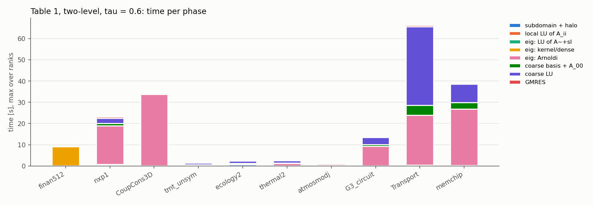
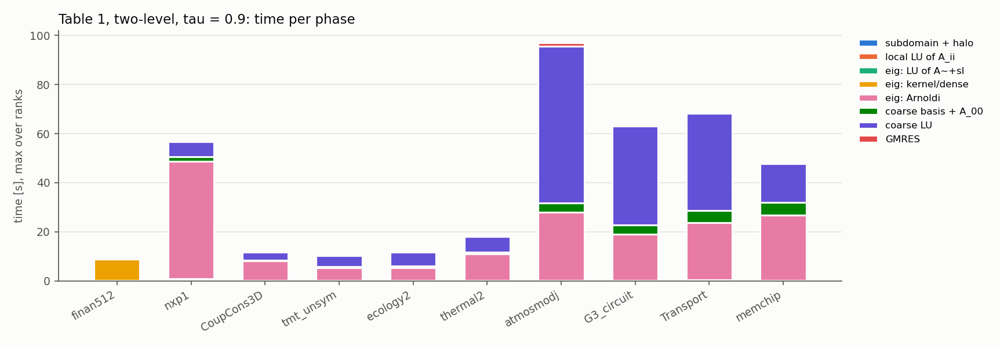
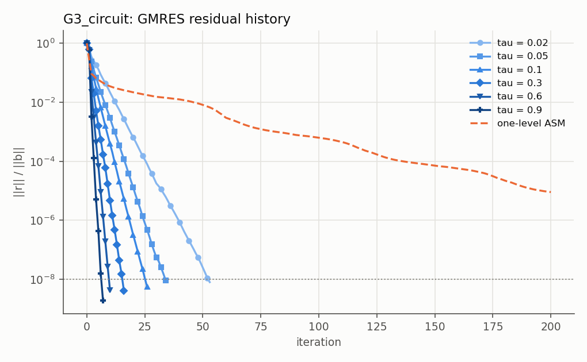
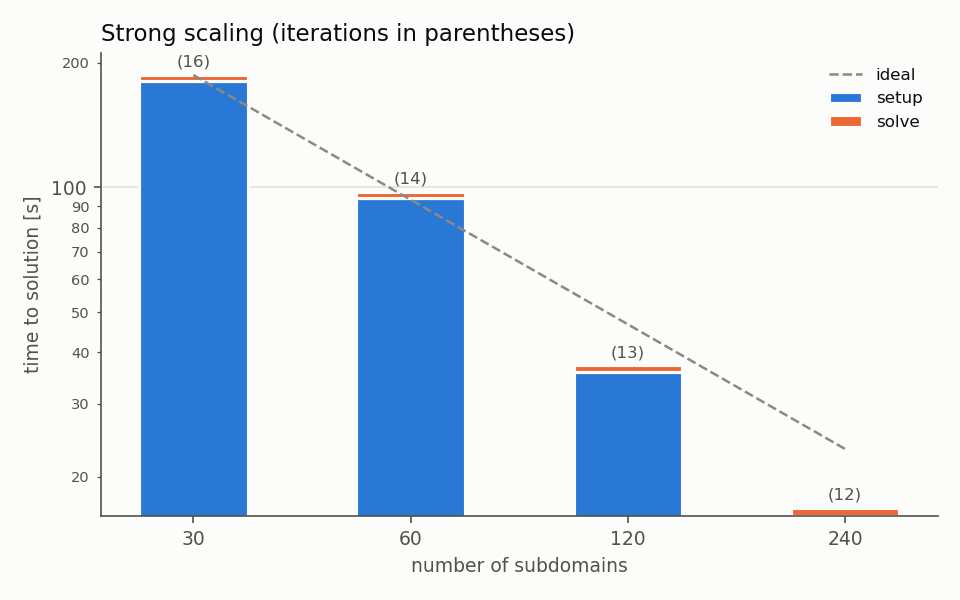
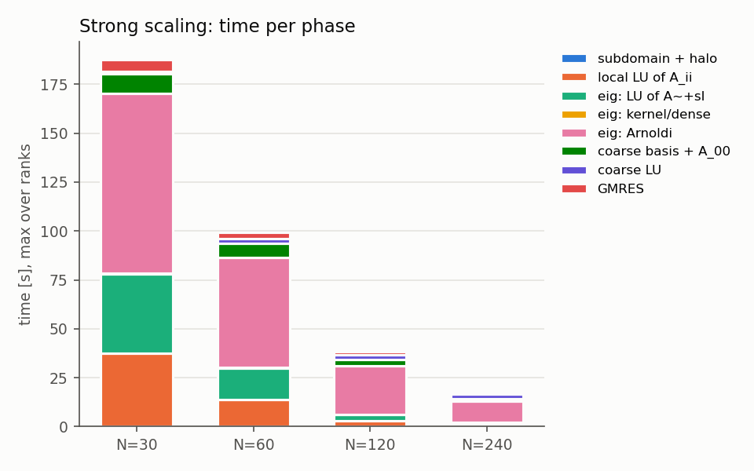
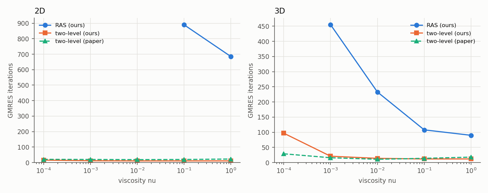

# schwarz2lvl vs Al Daas, Jolivet, Rees (SISC 2023)

Run directory `run_22861729`.

## Runs

- `test_subdomain` (16 processes): **ALL PASSED**
- `test_preconditioner` (16 processes): **ALL PASSED**
- git: `0d70f9f Readme Updates Ready for cineca testing`
- modules: `Currently Loaded Modulefiles: 1) profile/base(default) 2) cintools/1.0 3) profile/eng 4) autoload 5) intel/oneapi-2021--binary <aL> 6) intelmpi/oneapi-2021--binary <aL> 7) boost/1.76.0--intelmpi--oneapi-2021--binary <aL> 8) fftw/3.3.9--intelmpi--oneapi-2021--binary <aL> 9) openfoam/10 10) metis/5.1.0--gcc--10.2.0 11) intel-oneapi-mkl/2023.2.0 Key: (symbolic-version) <module-tag> <aL>=auto-loaded`

| run | np | status | its | true res. | n0 | setup [s] | solve [s] | wall [s] | error |
|:--|--:|:--|--:|--:|--:|--:|--:|--:|:--|
| fig2_ASM | 240 | not_converged | n.c. (200) | 9.1e-06 |  | 0.09 | 0.32 | 8 |  |
| fig2_tau0.02 | 240 | ok | 53 | 8.0e-09 | 853 | 0.47 | 0.13 | 8 |  |
| fig2_tau0.05 | 240 | ok | 34 | 9.2e-09 | 1936 | 0.52 | 0.10 | 7 |  |
| fig2_tau0.1 | 240 | ok | 26 | 5.6e-09 | 3545 | 0.85 | 0.11 | 9 |  |
| fig2_tau0.3 | 240 | ok | 16 | 4.1e-09 | 10052 | 2.45 | 0.18 | 9 |  |
| fig4_N120 | 120 | ok | 13 | 6.6e-09 | 7126 | 35.8 | 1.38 | 55 |  |
| fig4_N240 | 240 | ok | 12 | 5.4e-09 | 12827 | 16.1 | 0.71 | 36 |  |
| fig4_N30 | 30 | ok | 16 | 7.7e-09 | 1805 | 181 | 6.03 | 201 |  |
| fig4_N60 | 60 | ok | 14 | 7.6e-09 | 3616 | 94.1 | 3.39 | 115 |  |
| tab1_CoupCons3D_2L | 240 | ok | 23 | 6.5e-09 | 6968 | 34.3 | 0.20 | 46 |  |
| tab1_CoupCons3D_2L_t0.9 | 240 | ok | 21 | 4.6e-09 | 23422 | 11.5 | 0.39 | 25 |  |
| tab1_CoupCons3D_RAS | 240 | ok | 23 | 5.3e-09 |  | 0.09 | 0.05 | 13 |  |
| tab1_G3_circuit_2L | 240 | ok | 10 | 4.3e-09 | 25473 | 13.0 | 0.20 | 22 |  |
| tab1_G3_circuit_2L_t0.9 | 240 | ok | 7 | 1.9e-09 | 66910 | 61.3 | 0.51 | 69 |  |
| tab1_G3_circuit_RAS | 240 | not_converged | n.c. (200) | 2.0e-06 |  | 0.09 | 0.33 | 8 |  |
| tab1_Transport_2L | 240 | ok | 8 | 7.3e-09 | 65475 | 63.5 | 0.67 | 79 |  |
| tab1_Transport_2L_t0.9 | 240 | ok | 8 | 6.2e-09 | 72000 | 67.8 | 0.75 | 86 |  |
| tab1_Transport_RAS | 240 | not_converged | n.c. (200) | 2.5e-04 |  | 0.19 | 1.33 | 17 |  |
| tab1_atmosmodj_2L | 240 | ok | 71 | 9.4e-09 | 401 | 0.95 | 0.25 | 10 |  |
| tab1_atmosmodj_2L_t0.9 | 240 | ok | 14 | 5.8e-09 | 68736 | 93.9 | 1.46 | 104 |  |
| tab1_atmosmodj_RAS | 240 | ok | 79 | 9.3e-09 |  | 0.11 | 0.24 | 9 |  |
| tab1_circuit5M_dc_2L | 240 | timeout | T/O |  |  |  |  | 1200 |  |
| tab1_circuit5M_dc_RAS | 240 | ok | 10 | 6.5e-09 |  | 0.10 | 0.03 | 12 |  |
| tab1_ecology2_2L | 240 | ok | 8 | 1.6e-09 | 13380 | 2.35 | 0.20 | 8 |  |
| tab1_ecology2_2L_t0.9 | 240 | ok | 5 | 1.5e-09 | 31176 | 11.4 | 0.14 | 18 |  |
| tab1_ecology2_RAS | 240 | not_converged | n.c. (200) | 1.6e-03 |  | 0.54 | 0.15 | 7 |  |
| tab1_finan512_2L | 240 | ok | 6 | 2.8e-09 | 109 | 9.15 | 0.02 | 15 |  |
| tab1_finan512_2L_t0.9 | 240 | ok | 6 | 4.1e-10 | 5309 | 9.09 | 0.02 | 14 |  |
| tab1_finan512_RAS | 240 | ok | 6 | 2.8e-09 |  | 0.04 | 0.01 | 6 |  |
| tab1_memchip_2L | 240 | ok | 13 | 4.8e-09 | 39472 | 36.6 | 0.47 | 49 |  |
| tab1_memchip_2L_t0.9 | 240 | ok | 8 | 2.5e-09 | 53702 | 44.8 | 0.44 | 56 |  |
| tab1_memchip_RAS | 240 | ok | 44 | 6.5e-09 |  | 0.09 | 0.09 | 12 |  |
| tab1_nxp1_2L | 240 | ok | 42 | 7.0e-09 | 14060 | 22.1 | 0.58 | 29 |  |
| tab1_nxp1_2L_t0.9 | 240 | ok | 29 | 4.4e-09 | 22832 | 55.8 | 0.46 | 63 |  |
| tab1_nxp1_RAS | 240 | not_converged | n.c. (200) | 4.6e-05 |  | 0.25 | 0.60 | 8 |  |
| tab1_thermal2_2L | 240 | ok | 7 | 6.2e-09 | 16251 | 2.34 | 0.10 | 10 |  |
| tab1_thermal2_2L_t0.9 | 240 | ok | 5 | 1.0e-09 | 33435 | 17.7 | 0.16 | 26 |  |
| tab1_thermal2_RAS | 240 | not_converged | n.c. (200) | 1.9e-03 |  | 0.09 | 0.24 | 9 |  |
| tab1_tmt_unsym_2L | 240 | ok | 8 | 1.6e-09 | 13075 | 1.36 | 0.10 | 8 |  |
| tab1_tmt_unsym_2L_t0.9 | 240 | ok | 5 | 1.5e-09 | 30620 | 9.97 | 0.13 | 18 |  |
| tab1_tmt_unsym_RAS | 240 | not_converged | n.c. (200) | 4.7e-03 |  | 0.07 | 0.13 | 7 |  |
| tab2_2d_nu1_2L | 240 | ok | 11 | 4.3e-09 | 7443 | 1.11 | 0.09 | 8 |  |
| tab2_2d_nu1_RAS | 240 | ok | 685 | 8.7e-09 |  | 0.08 | 0.83 | 7 |  |
| tab2_2d_nu1e-1_2L | 240 | ok | 11 | 4.3e-09 | 7445 | 1.10 | 0.09 | 8 |  |
| tab2_2d_nu1e-1_RAS | 240 | ok | 890 | 9.8e-09 |  | 0.08 | 1.20 | 8 |  |
| tab2_2d_nu1e-2_2L | 240 | ok | 11 | 4.4e-09 | 7378 | 1.19 | 0.09 | 7 |  |
| tab2_2d_nu1e-2_RAS | 240 | not_converged | n.c. (1000) | 5.7e-08 |  | 0.08 | 1.33 | 8 |  |
| tab2_2d_nu1e-3_2L | 240 | ok | 12 | 4.0e-09 | 6545 | 1.05 | 0.08 | 7 |  |
| tab2_2d_nu1e-3_RAS | 240 | not_converged | n.c. (1000) | 1.6e-05 |  | 0.09 | 1.21 | 8 |  |
| tab2_2d_nu1e-4_2L | 240 | ok | 16 | 3.9e-09 | 3493 | 0.95 | 0.06 | 7 |  |
| tab2_2d_nu1e-4_RAS | 240 | not_converged | n.c. (1000) | 3.0e-04 |  | 0.09 | 1.34 | 8 |  |
| tab2_3d_nu1_2L | 240 | ok | 12 | 7.7e-09 | 2524 | 1.34 | 0.04 | 7 |  |
| tab2_3d_nu1_RAS | 240 | ok | 90 | 9.5e-09 |  | 0.07 | 0.07 | 7 |  |
| tab2_3d_nu1e-1_2L | 240 | ok | 12 | 7.6e-09 | 2514 | 0.48 | 0.04 | 7 |  |
| tab2_3d_nu1e-1_RAS | 240 | ok | 108 | 9.4e-09 |  | 0.08 | 0.09 | 7 |  |
| tab2_3d_nu1e-2_2L | 240 | ok | 14 | 2.9e-09 | 2341 | 0.44 | 0.04 | 7 |  |
| tab2_3d_nu1e-2_RAS | 240 | ok | 233 | 9.6e-09 |  | 0.07 | 0.18 | 10 |  |
| tab2_3d_nu1e-3_2L | 240 | ok | 21 | 6.6e-09 | 1304 | 1.30 | 0.04 | 7 |  |
| tab2_3d_nu1e-3_RAS | 240 | ok | 455 | 9.9e-09 |  | 0.89 | 0.33 | 7 |  |
| tab2_3d_nu1e-4_2L | 240 | ok | 97 | 8.9e-09 | 710 | 0.51 | 0.13 | 6 |  |
| tab2_3d_nu1e-4_RAS | 240 | not_converged | n.c. (1000) | 1.4e-05 |  | 0.07 | 0.70 | 7 |  |

`*` = GMRES reports convergence but the recomputed true residual is above 2 rtol; n.c. = not converged within maxit; T/O = stopped by RUN_TIMEOUT; killed = the job ended during the run.

## Table 1 - SuiteSparse matrices (nev = 300)

Ours: N = 240 subdomains, RAS = one-level, 2L = RAS + deflated coarse correction (2.4) at tau = 0.6, 0.9. Paper: N = 256, tau = 0.6; AMG columns = AGMG / BoomerAMG / GAMG (F = failure, C = complex). Compare n0/N, since N differs. In the paper the G3_circuit row (8 it., n0 = 71,385) is the tau = 0.9 point of its Fig. 2, not tau = 0.6 (11 it., n0 = 34,402).

| matrix | n | N | RAS its | 2L its tau=0.6 | n0/N tau=0.6 | 2L its tau=0.9 | n0/N tau=0.9 | paper its | paper n0/N | paper AMG its | 2L setup tau=0.6 [s] | 2L setup tau=0.9 [s] |
|:--|--:|--:|--:|--:|--:|--:|--:|--:|--:|--:|--:|--:|
| finan512 | 74752 | 240 | 6 | 6 | 0 | 6 | 22 | 6 | 10 | 9/7/8 | 9.15 | 9.09 |
| nxp1 | 414604 | 240 | n.c. (200) | 42 | 59 | 29 | 95 | 20 | 77 | F/F/F | 22.1 | 55.8 |
| CoupCons3D | 416800 | 240 | 23 | 23 | 29 | 21 | 98 | 20 | 113 | >100/F/26 | 34.3 | 11.5 |
| tmt_unsym | 917825 | 240 | n.c. (200) | 8 | 54 | 5 | 128 | 6 | 129 | 23/13/18 | 1.36 | 9.97 |
| ecology2 | 999999 | 240 | n.c. (200) | 8 | 56 | 5 | 130 | 6 | 133 | 18/12/18 | 2.35 | 11.4 |
| thermal2 | 1228045 | 240 | n.c. (200) | 7 | 68 | 5 | 139 | 26 | 157 | 18/14/20 | 2.34 | 17.7 |
| atmosmodj | 1270432 | 240 | 79 | 71 | 2 | 14 | 286 | 7 | 298 | F/8/17 | 0.95 | 93.9 |
| G3_circuit | 1585478 | 240 | n.c. (200) | 10 | 106 | 7 | 279 | 8 | 279 | 25/12/35 | 13.0 | 61.3 |
| Transport | 1602111 | 240 | n.c. (200) | 8 | 273 | 8 | 300 | 9 | 300 | 18/10/98 | 63.5 | 67.8 |
| memchip | 2707524 | 240 | 44 | 13 | 164 | 8 | 224 | 36 | 226 | F/15/F | 36.6 | 44.8 |
| circuit5M_dc | 3523317 | 240 | 10 | T/O |  |  |  | 7 | 34 | F/5/>100 |  |  |

## Fig. 2 - G3_circuit, influence of tau (nev = 300)

| tau | n0 | its | paper n0 | paper its | setup [s] | solve [s] |
|:--|--:|--:|--:|--:|--:|--:|
| 0.02 | 853 | 53 | 739 | 75 | 0.47 | 0.13 |
| 0.05 | 1936 | 34 | 1831 | 44 | 0.52 | 0.10 |
| 0.1 | 3545 | 26 | 3608 | 31 | 0.85 | 0.11 |
| 0.3 | 10052 | 16 | 11784 | 18 | 2.45 | 0.18 |
| 0.6 | 25473 | 10 | 34402 | 11 | 13.0 | 0.20 |
| 0.9 | 66910 | 7 | 71385 | 8 | 61.3 | 0.51 |
| one-level ASM | - | n.c. (200) | - | no conv. | 0.09 | 0.32 |

## Fig. 4 - strong scaling, 3D convection-diffusion, nu = 1e-2 (tau = 0.3, nev = 60)

Ours: convdiff3d 200x200x200 nu=0.01 (n=8000000, nnz=55760000). Paper: n = 8.1e6 (P2 elements), iterations 28, 21, 19, 20, 15 for N = 32, 64, 128, 256, 512. Speedup and efficiency relative to N = 30.

| N | n_I avg | n0 | its | paper its | setup [s] | solve [s] | total [s] | speedup | efficiency |
|:--|--:|--:|--:|--:|--:|--:|--:|--:|--:|
| 30 | 266667 | 1805 | 16 |  | 181 | 6.03 | 187 | 30.0 | 1.00 |
| 60 | 133333 | 3616 | 14 |  | 94.1 | 3.39 | 97.5 | 57.5 | 0.96 |
| 120 | 66667 | 7126 | 13 |  | 35.8 | 1.38 | 37.2 | 150.7 | 1.26 |
| 240 | 33333 | 12827 | 12 |  | 16.1 | 0.71 | 16.8 | 332.9 | 1.39 |

## Table 2 - convection-diffusion (4.1), nu = 1 ... 1e-4 (tau = 0.3, nev = 60)

Ours: finite volumes with upwind, N = 240, ~6k unknowns per subdomain in 2D and ~2k in 3D. Paper: SUPG finite elements, same subdomain sizes, N = 1024 (2D) and 4096 (3D). Compare iterations and n0/N.

| dim | nu | RAS its | 2L its | n0 | n0/N | paper its | paper n0/N | 2L setup [s] | 2L solve [s] |
|:--|--:|--:|--:|--:|--:|--:|--:|--:|--:|
| 2D | 1 | 685 | 11 | 7443 | 31 | 23 | 52 | 1.11 | 0.09 |
| 2D | 0.1 | 890 | 11 | 7445 | 31 | 20 | 52 | 1.10 | 0.09 |
| 2D | 0.01 | n.c. (1000) | 11 | 7378 | 31 | 19 | 52 | 1.19 | 0.09 |
| 2D | 0.001 | n.c. (1000) | 12 | 6545 | 27 | 20 | 46 | 1.05 | 0.08 |
| 2D | 0.0001 | n.c. (1000) | 16 | 3493 | 15 | 21 | 28 | 0.95 | 0.06 |
| 3D | 1 | 90 | 12 | 2524 | 11 | 18 | 44 | 1.34 | 0.04 |
| 3D | 0.1 | 108 | 12 | 2514 | 10 | 14 | 44 | 0.48 | 0.04 |
| 3D | 0.01 | 233 | 14 | 2341 | 10 | 11 | 39 | 0.44 | 0.04 |
| 3D | 0.001 | 455 | 21 | 1304 | 5 | 16 | 24 | 1.30 | 0.04 |
| 3D | 0.0001 | n.c. (1000) | 97 | 710 | 3 | 29 | 19 | 0.51 | 0.13 |

## Time per phase (max over ranks, seconds)

Same timers as the local runs; `phases.csv` has min / avg / max of every timer, the logs the full table. decomposition = rank 0 reads/generates, partitions and scatters the matrix (OpenFOAM: decomposePar).

| run | np | decomp. | subdomain + halo | local LU of A_ii | eig: LU of A~+sI | eig: kernel/dense | eig: Arnoldi | coarse basis + A_00 | coarse LU | GMRES | setup | solve | total |
|:--|--:|--:|--:|--:|--:|--:|--:|--:|--:|--:|--:|--:|--:|
| fig2_ASM | 240 | 2.87 | 0.02 | 0.06 |  |  |  |  |  | 0.32 | 0.09 | 0.32 | 0.41 |
| fig2_tau0.02 | 240 | 2.74 | 0.02 | 0.06 | 0.05 | 0.04 | 0.28 | 0.02 | 0.02 | 0.13 | 0.47 | 0.13 | 0.60 |
| fig2_tau0.05 | 240 | 2.71 | 0.01 | 0.07 | 0.05 | 0.04 | 0.28 | 0.05 | 0.05 | 0.10 | 0.52 | 0.10 | 0.62 |
| fig2_tau0.1 | 240 | 2.78 | 0.02 | 0.05 | 0.05 | 0.04 | 0.53 | 0.12 | 0.13 | 0.11 | 0.85 | 0.11 | 0.96 |
| fig2_tau0.3 | 240 | 2.62 | 0.03 | 0.05 | 0.05 | 0.04 | 1.58 | 0.37 | 0.59 | 0.18 | 2.45 | 0.18 | 2.63 |
| fig4_N120 | 120 | 14.1 | 0.06 | 2.97 | 3.08 | 0.14 | 24.6 | 3.40 | 2.51 | 1.38 | 35.8 | 1.38 | 37.2 |
| fig4_N240 | 240 | 14.7 | 0.04 | 0.97 | 0.89 | 0.10 | 10.8 | 1.51 | 2.37 | 0.71 | 16.1 | 0.71 | 16.8 |
| fig4_N30 | 30 | 11.4 | 0.16 | 37.3 | 40.5 | 0.34 | 92.0 | 10.2 | 0.88 | 6.03 | 181 | 6.03 | 187 |
| fig4_N60 | 60 | 13.3 | 0.11 | 13.8 | 15.9 | 0.40 | 56.3 | 7.07 | 2.34 | 3.39 | 94.1 | 3.39 | 97.5 |
| tab1_CoupCons3D_2L | 240 | 7.83 | 0.02 | 0.06 | 0.05 | 0.01 | 33.6 | 0.14 | 0.53 | 0.20 | 34.3 | 0.20 | 34.6 |
| tab1_CoupCons3D_2L_t0.9 | 240 | 8.00 | 0.02 | 0.06 | 0.05 | 0.01 | 7.98 | 0.24 | 3.29 | 0.39 | 11.5 | 0.39 | 11.9 |
| tab1_CoupCons3D_RAS | 240 | 8.17 | 0.02 | 0.06 |  |  |  |  |  | 0.05 | 0.09 | 0.05 | 0.14 |
| tab1_G3_circuit_2L | 240 | 4.83 | 0.01 | 0.07 | 0.05 | 0.04 | 9.13 | 0.86 | 3.36 | 0.20 | 13.0 | 0.20 | 13.2 |
| tab1_G3_circuit_2L_t0.9 | 240 | 2.63 | 0.03 | 0.06 | 0.04 | 0.05 | 18.9 | 3.77 | 40.2 | 0.51 | 61.3 | 0.51 | 61.8 |
| tab1_G3_circuit_RAS | 240 | 2.99 | 0.02 | 0.07 |  |  |  |  |  | 0.33 | 0.09 | 0.33 | 0.42 |
| tab1_Transport_2L | 240 | 10.4 | 0.03 | 0.15 | 0.14 | 0.05 | 23.6 | 4.71 | 37.0 | 0.67 | 63.5 | 0.67 | 64.2 |
| tab1_Transport_2L_t0.9 | 240 | 12.2 | 0.02 | 0.15 | 0.15 | 0.06 | 23.2 | 5.02 | 39.6 | 0.75 | 67.8 | 0.75 | 68.5 |
| tab1_Transport_RAS | 240 | 11.2 | 0.03 | 0.16 |  |  |  |  |  | 1.33 | 0.19 | 1.33 | 1.53 |
| tab1_atmosmodj_2L | 240 | 4.17 | 0.02 | 0.08 | 0.07 | 0.04 | 0.71 | 0.01 | 0.01 | 0.25 | 0.95 | 0.25 | 1.20 |
| tab1_atmosmodj_2L_t0.9 | 240 | 4.21 | 0.02 | 0.08 | 0.07 | 0.04 | 27.7 | 3.95 | 63.8 | 1.46 | 93.9 | 1.46 | 95.3 |
| tab1_atmosmodj_RAS | 240 | 4.35 | 0.02 | 0.08 |  |  |  |  |  | 0.24 | 0.11 | 0.24 | 0.34 |
| tab1_circuit5M_dc_RAS | 240 | 8.35 | 0.02 | 0.08 |  |  |  |  |  | 0.03 | 0.10 | 0.03 | 0.13 |
| tab1_ecology2_2L | 240 | 1.45 | 0.57 | 0.05 | 0.02 | 0.03 | 0.49 | 0.14 | 1.11 | 0.20 | 2.35 | 0.20 | 2.55 |
| tab1_ecology2_2L_t0.9 | 240 | 1.69 | 0.01 | 0.05 | 0.02 | 0.03 | 5.20 | 0.63 | 5.80 | 0.14 | 11.4 | 0.14 | 11.5 |
| tab1_ecology2_RAS | 240 | 1.59 | 0.48 | 0.05 |  |  |  |  |  | 0.15 | 0.54 | 0.15 | 0.69 |
| tab1_finan512_2L | 240 | 0.87 | 0.07 | 0.03 |  | 9.00 |  | 0.01 | 0.02 | 0.02 | 9.15 | 0.02 | 9.17 |
| tab1_finan512_2L_t0.9 | 240 | 1.07 | 0.02 | 0.03 |  | 8.91 |  | 0.01 | 0.11 | 0.02 | 9.09 | 0.02 | 9.11 |
| tab1_finan512_RAS | 240 | 2.27 | 0.01 | 0.03 |  |  |  |  |  | 0.01 | 0.04 | 0.01 | 0.05 |
| tab1_memchip_2L | 240 | 6.95 | 0.02 | 0.07 | 0.05 | 0.08 | 26.6 | 3.17 | 8.62 | 0.47 | 36.6 | 0.47 | 37.1 |
| tab1_memchip_2L_t0.9 | 240 | 7.00 | 0.01 | 0.07 | 0.05 | 0.08 | 26.6 | 5.06 | 15.7 | 0.44 | 44.8 | 0.44 | 45.3 |
| tab1_memchip_RAS | 240 | 7.35 | 0.02 | 0.07 |  |  |  |  |  | 0.09 | 0.09 | 0.09 | 0.18 |
| tab1_nxp1_2L | 240 | 2.03 | 0.11 | 0.16 | 0.16 | 0.32 | 18.2 | 1.02 | 2.46 | 0.58 | 22.1 | 0.58 | 22.7 |
| tab1_nxp1_2L_t0.9 | 240 | 1.70 | 0.12 | 0.15 | 0.17 | 0.38 | 47.9 | 1.95 | 6.05 | 0.46 | 55.8 | 0.46 | 56.3 |
| tab1_nxp1_RAS | 240 | 2.47 | 0.10 | 0.15 |  |  |  |  |  | 0.60 | 0.25 | 0.60 | 0.86 |
| tab1_thermal2_2L | 240 | 3.04 | 0.03 | 0.08 | 0.04 | 0.03 | 1.00 | 0.23 | 1.06 | 0.10 | 2.34 | 0.10 | 2.44 |
| tab1_thermal2_2L_t0.9 | 240 | 3.25 | 0.01 | 0.06 | 0.04 | 0.03 | 10.8 | 0.83 | 6.33 | 0.16 | 17.7 | 0.16 | 17.8 |
| tab1_thermal2_RAS | 240 | 5.06 | 0.02 | 0.06 |  |  |  |  |  | 0.24 | 0.09 | 0.24 | 0.33 |
| tab1_tmt_unsym_2L | 240 | 2.16 | 0.02 | 0.04 | 0.02 | 0.04 | 0.37 | 0.12 | 0.80 | 0.10 | 1.36 | 0.10 | 1.46 |
| tab1_tmt_unsym_2L_t0.9 | 240 | 2.57 | 0.01 | 0.05 | 0.02 | 0.05 | 5.21 | 0.47 | 4.37 | 0.13 | 9.97 | 0.13 | 10.1 |
| tab1_tmt_unsym_RAS | 240 | 2.47 | 0.02 | 0.05 |  |  |  |  |  | 0.13 | 0.07 | 0.13 | 0.20 |
| tab2_2d_nu1_2L | 240 | 1.99 | 0.05 | 0.06 | 0.03 | 0.07 | 0.52 | 0.09 | 0.33 | 0.09 | 1.11 | 0.09 | 1.20 |
| tab2_2d_nu1_RAS | 240 | 2.18 | 0.02 | 0.05 |  |  |  |  |  | 0.83 | 0.08 | 0.83 | 0.90 |
| tab2_2d_nu1e-1_2L | 240 | 2.09 | 0.02 | 0.06 | 0.03 | 0.07 | 0.53 | 0.09 | 0.34 | 0.09 | 1.10 | 0.09 | 1.18 |
| tab2_2d_nu1e-1_RAS | 240 | 2.10 | 0.02 | 0.05 |  |  |  |  |  | 1.20 | 0.08 | 1.20 | 1.29 |
| tab2_2d_nu1e-2_2L | 240 | 1.91 | 0.15 | 0.06 | 0.03 | 0.07 | 0.49 | 0.09 | 0.33 | 0.09 | 1.19 | 0.09 | 1.28 |
| tab2_2d_nu1e-2_RAS | 240 | 2.53 | 0.01 | 0.06 |  |  |  |  |  | 1.33 | 0.08 | 1.33 | 1.41 |
| tab2_2d_nu1e-3_2L | 240 | 2.03 | 0.05 | 0.05 | 0.03 | 0.07 | 0.53 | 0.08 | 0.27 | 0.08 | 1.05 | 0.08 | 1.13 |
| tab2_2d_nu1e-3_RAS | 240 | 2.07 | 0.02 | 0.07 |  |  |  |  |  | 1.21 | 0.09 | 1.21 | 1.30 |
| tab2_2d_nu1e-4_2L | 240 | 1.86 | 0.01 | 0.06 | 0.03 | 0.07 | 0.66 | 0.05 | 0.09 | 0.06 | 0.95 | 0.06 | 1.01 |
| tab2_2d_nu1e-4_RAS | 240 | 2.47 | 0.02 | 0.06 |  |  |  |  |  | 1.34 | 0.09 | 1.34 | 1.43 |
| tab2_3d_nu1_2L | 240 | 1.17 | 0.89 | 0.04 | 0.02 | 0.03 | 0.25 | 0.01 | 0.08 | 0.04 | 1.34 | 0.04 | 1.38 |
| tab2_3d_nu1_RAS | 240 | 2.52 | 0.02 | 0.05 |  |  |  |  |  | 0.07 | 0.07 | 0.07 | 0.14 |
| tab2_3d_nu1e-1_2L | 240 | 2.30 | 0.02 | 0.07 | 0.02 | 0.03 | 0.24 | 0.01 | 0.08 | 0.04 | 0.48 | 0.04 | 0.52 |
| tab2_3d_nu1e-1_RAS | 240 | 2.27 | 0.01 | 0.06 |  |  |  |  |  | 0.09 | 0.08 | 0.09 | 0.16 |
| tab2_3d_nu1e-2_2L | 240 | 2.17 | 0.01 | 0.04 | 0.02 | 0.03 | 0.25 | 0.01 | 0.07 | 0.04 | 0.44 | 0.04 | 0.49 |
| tab2_3d_nu1e-2_RAS | 240 | 4.77 | 0.02 | 0.05 |  |  |  |  |  | 0.18 | 0.07 | 0.18 | 0.25 |
| tab2_3d_nu1e-3_2L | 240 | 1.18 | 0.87 | 0.05 | 0.02 | 0.04 | 0.28 | 0.01 | 0.03 | 0.04 | 1.30 | 0.04 | 1.34 |
| tab2_3d_nu1e-3_RAS | 240 | 1.22 | 0.84 | 0.04 |  |  |  |  |  | 0.33 | 0.89 | 0.33 | 1.23 |
| tab2_3d_nu1e-4_2L | 240 | 1.14 | 0.02 | 0.05 | 0.02 | 0.03 | 0.37 | 0.01 | 0.01 | 0.13 | 0.51 | 0.13 | 0.65 |
| tab2_3d_nu1e-4_RAS | 240 | 1.18 | 0.01 | 0.05 |  |  |  |  |  | 0.70 | 0.07 | 0.70 | 0.77 |

