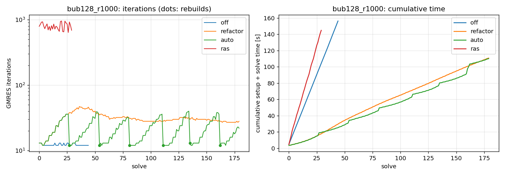
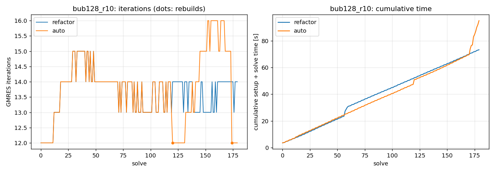
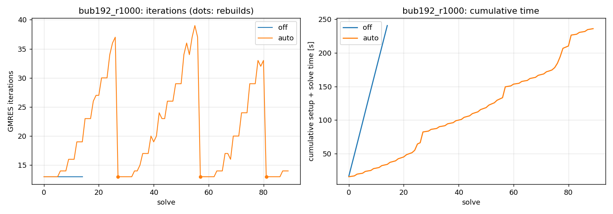
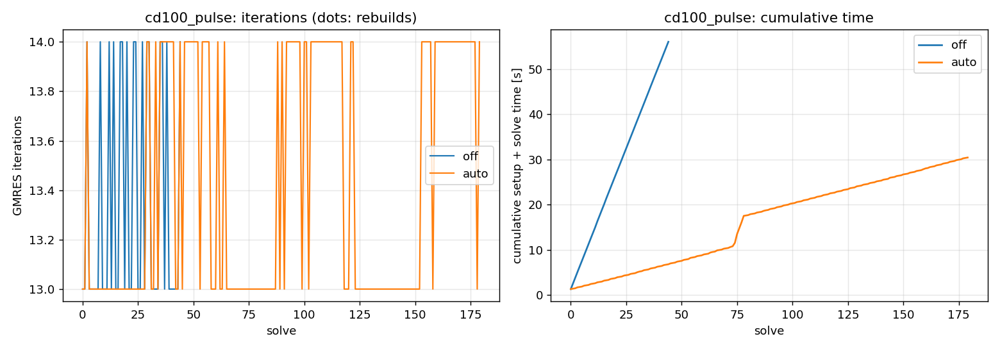

# Setup reuse (P1) on G100: results

Job `run_reuse_23011246` (`Allrun_reuse.sh`): 5 nodes x 48 = 240 MPI processes (one subdomain each),
local factorizations with MKL PARDISO, A_00 with `cluster_sparse_solver` on 48 processes, on rank 0
when n0 < 10000. Sources: P1 + fixes (md5 `ddd6f06ea96a`, `src_hash.txt`). Unit tests on 16
processes: all passed (`test_subdomain` 28, `test_preconditioner` 192, `test_reuse` 107 checks).
Full tables and iteration sequences: [`report.md`](run_reuse_23011246/report.md).

Every run is a time loop of steps x 3 correctors (same matrix, new random rhs), GMRES(30) with
rtol 1e-8 from x0 = 0: `off` = full setup before every solve (no persistent state, the reference),
`refactor` = numerical refactorizations, coarse basis never rebuilt, `auto` = rebuild at break-even.

## In short

| problem | off [s/solve] | auto [s/solve] | speedup | speedup, median times | auto: refact. / rebuilds | iterations avg (off -> auto) |
|:--|--:|--:|--:|--:|--:|--:|
| bubbles3d 128^3, rho 1000 | 3.47 | 0.611 | 5.7x | 6.2x | 53 / 6 | 12.3 -> 20.6 |
| bubbles3d 192^3, rho 1000 | 16.0 | 2.62 | 6.1x | 7.0x | 26 / 3 | 13.0 -> 20.7 |
| convdiff3d 100^3, pulsating (nonsym.) | 1.25 | 0.169 | 7.4x | 9.4x | 59 / 0 | 13.4 -> 13.4 |
| bubbles3d 128^3, rho 10 | - | 0.528 (refactor 0.407) | - | auto +12% vs refactor | 57 / 2 | 13.7 (refactor) / 13.8 |
| one-level RAS, 128^3, rho 1000 | - | 4.83 | 0.7x vs off | - | 9 / 0 | 794 |

*cost/solve* = (initial setup + updates + solves) / solves. *median times*: the same cost with the
median time per iteration and per update of each run, i.e. without the timing bursts described in
[Timing noise](#reproducibility-and-timing-noise).

- Reusing the setup makes a solve 6-9x cheaper than rebuilding the preconditioner every time
  (what happens without a persistent state, e.g. a new solver object at every `solve()`).
- All 1125 solves converged (true residual <= 1e-8). No numerical refactorization fell back to a
  full factorization, local or coarse, including the nonsymmetric sequence (PARDISO keeps the
  scaling/matching of the first analysis).
- The coarse space is indispensable: one-level RAS needs ~800 iterations and is slower than
  rebuilding the two-level preconditioner before every solve.

## Plots

Left: GMRES iterations per solve (dots: rebuilds chosen by `auto`). Right: cumulative setup + solve time.

### bubbles3d 128^3, rho 1000

With `refactor` the iterations grow from 12 to 47 in 12 steps, then settle around 30: the coarse
basis was computed for bubble positions that are no longer there (at high contrast the low-energy
modes are nearly constant on each bubble), while the part of the basis that does not depend on the
bubbles keeps working. `auto` rebuilds every ~9 steps (saw-tooth 12 -> 31-39). The two cumulative
curves end together here (0.611 vs 0.615 s/solve); with median times `auto` is 7% cheaper
(0.563 vs 0.606), as in the previous job. The jump of `auto` near solve 160 is a timing burst
(one solve at 10x the usual time per iteration), not a rebuild.

### bubbles3d 128^3, rho 10

Low contrast: the basis ages only from 12 to 15-16 iterations, so a rebuild saves 1-3 iterations
per solve and barely pays for itself. `auto` rebuilt at steps 40 and 58 and costs 12% more than never
rebuilding (median times; 5% with one rebuild in the previous job). The rebuild at step 58 cannot pay
back before the end of a 60-step test; in a simulation the loop would go on. The jumps at solves
57-59 (`refactor`) and 171-174 (`auto`) are timing bursts.

### bubbles3d 192^3, rho 1000

Subdomains of ~30k cells (m_i up to 60 = `--nev`): a rebuild costs 15.5 s, a refactorization 2.0 s;
`auto` rebuilds every 8-10 steps. Three rebuilds instead of two in the previous job: the third cycle
is shorter because timing bursts at solves 76-78 (5-7x per iteration) inflate the measured waste.

### convdiff3d 100^3, pulsating convection (nonsymmetric)

The coarse basis does not age (13-14 iterations throughout), so `auto` never rebuilds: every step is
a numerical refactorization (0.16 s instead of a 1.16 s setup). The jump near solve 75 is a timing burst.

## Fixes verified

- One-level RAS with `--reuse auto` runs as `refactor` ("one-level: no coarse basis to rebuild"):
  0 rebuilds (27 in the previous job, triggered by noise in ~800-iteration solves).
- Every log reports the refactorizations falling back to a full factorization: 0 in all runs.
- Logarithmic y axis when the iterations span more than 10x (`bub128_r1000`, with RAS).
- `src_hash.txt` identifies the compiled sources (the job ran outside a git checkout).

## Reproducibility and timing noise

The fixes do not touch the solve path. Compared with the previous job (`run_reuse_22991747`):

- levels, iterations and n0 are **identical solve by solve** in 7 of the 9 two-level runs; in `bub128_r10_auto`
  and `bub192_r1000_auto` they are identical up to the first rebuild decision, which came one step
  earlier (the decisions use measured times);
- the median time per iteration is +5-6% at 128^3 (15.1 vs 14.3 ms) and +14% at 192^3
  (49.8 vs 43.7 ms), and the purely local work (solves with the factors of A_ii) is +4-6%;
- but some solves took 5-10x the median time per iteration (`bub128_r10_auto` 171-174,
  `bub128_r10_refactor` 57-59, `bub192_r1000_auto` 25 and 76-78, `cd100_pulse_auto` 74-78). The
  extra time sits in the communication-bound parts: in `cd100_pulse_auto`, per iteration, local
  solves 1.68 -> 1.74 ms, but the rest of the iteration outside the preconditioner and the SpMV
  (GMRES orthogonalization, i.e. global reductions) 0.46 -> 1.96 ms.
  This points to interconnect/system noise during the job, not to the code.

The long runs therefore have inflated means; with median times the speedups of the previous job
are reproduced (6.2x / 7.0x / 9.4x here, 6.2x / 7.5x / 9.5x there).

## Where the time goes with `auto` (targets for P2)

Timers averaged over the ranks, share of the total setup + update + solve time:

| | coarse solves | coarse factorizations | local solves | eigensolver | local factorizations | A_00 = V^T A V in refactorizations |
|:--|--:|--:|--:|--:|--:|--:|
| 128^3 (110 s) | 28% | 20% | 16% | 14% | 3% | 1% |
| 192^3 (236 s) | 14% | 16% | 18% | 17% | 5% | 5% |

Factorizations and solves with the factors take 53-66% of the time: P2 (Cholesky for the symmetric
matrices, optional single-precision local factors) addresses exactly these.

## Open points

1. **Policy and timing bursts.** The waste uses the measured time of each solve, so a burst can
   bring a rebuild forward (`bub192_r1000_auto`). Possible fix: cap the time per iteration used in
   the waste (e.g. at 1.5x its median since the last rebuild).
2. **Low contrast.** When rebuilds barely help (rho 10), `auto` may cost 5-12% more than never
   rebuilding: the price of the break-even rule; its "at most 2x the hindsight optimum" bound holds
   for a constant rent, not here, so it is a heuristic.
3. **A_00 in refactorizations.** `CoarseSpace::computeEntries()` takes ~0.45 s of the 2.0 s of a
   refactorization at 192^3 (sparse x sparse product with a storage-order conversion): reordering
   the two products should bring it to a few tens of ms.
4. **nev cap at 192^3.** m_i reaches 60 = `--nev` on some subdomains: the selection by tau is
   truncated there (iterations after a rebuild are still 13).